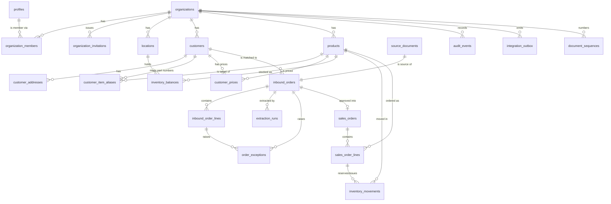

# OrderPilot: Database Architecture

| | |
|---|---|
| **Status** | v0.3: Phase 2A decisions and Q-1 to Q-5 approved; schema implemented in Phase 2A |
| **Date** | 2026-10-20 |
| **Database** | Supabase PostgreSQL (Postgres 15 or later) |
| **Depends on** | [PRODUCT_REQUIREMENTS.md](PRODUCT_REQUIREMENTS.md) §5, §8, §9, §15 |

This is a design, not a migration script. Column lists are complete enough to review the model; exact SQL will be written in Phase 2 and verified by the database tests in [TESTING_STRATEGY.md](TESTING_STRATEGY.md).

---

## 1. Design principles

1. **The database is the last line of defence.** Tenant isolation, permissions for sensitive actions, state transitions, inventory rules and duplicate prevention are enforced in Postgres, not only in application code. A client that bypasses the UI must still be unable to break a rule.
2. **Every tenant row carries `organization_id`.** No exceptions, including child tables, so every policy is a simple, indexed check.
3. **Cross-tenant references are impossible by construction.** Child tables reference parents through composite foreign keys on `(organization_id, id)`.
4. **Facts are append-only.** Audit events, inventory movements and raw extraction output are never updated or deleted.
5. **Suggestions and confirmed data are stored separately.** Raw AI output lives on extraction runs; the working draft carries provenance per field; sales orders hold only confirmed values.
6. **Multi-step business operations are single database functions.** Approval, cancellation, fulfilment and stock changes each run in one transaction with explicit row locks.
7. **Exact numbers.** `numeric` for money and quantities, never floating point.
8. **No hard deletes of business records.** Status fields (`inactive`, `discontinued`, `cancelled`) instead.

---

## 2. Tenancy model

**Chosen:** shared database, shared schema, `organization_id` on every tenant table, enforced by row-level security (RLS).

| Option | Isolation | Cost and operations | Fit |
|---|---|---|---|
| **Shared schema + RLS (chosen)** | Logical, enforced by Postgres policies | One database, one migration path | Best for SMB SaaS; standard Supabase pattern |
| Schema per tenant | Stronger logical separation | Migrations multiply per tenant; poor fit with Supabase APIs | Not recommended |
| Database (project) per tenant | Physical | Highest cost; separate deployments | Available through the **dedicated instance** option (D-01) using the same code and schema |

The same schema runs unchanged in a dedicated single-customer deployment; that deployment simply contains one organisation.

**Active workspace.** The active workspace comes from the URL (`/o/{slug}/…`), not from a token claim. RLS checks membership on every row, so switching workspaces needs no token refresh and a stale token can never grant access to a workspace the user was removed from.

---

## 3. Conventions

| Topic | Convention |
|---|---|
| Naming | `snake_case`, plural table names, singular enum type names. |
| Primary keys | `id uuid default gen_random_uuid()`. High-volume append-only tables (`audit_events`, `inventory_movements`, `integration_outbox`) use `bigint generated always as identity`. |
| Tenant key | `organization_id uuid not null` on every tenant table, plus `unique (organization_id, id)` on parents to support composite foreign keys. |
| Human references | Per-workspace sequences: intakes `IN-001042`, sales orders `SO-2026-000123`. |
| Timestamps | `created_at`, `updated_at timestamptz not null default now()`; `updated_at` maintained by trigger. Business dates (PO date, requested date) are `date`. |
| Actors | `created_by`, `updated_by uuid` referencing `profiles(id)`. |
| Money | `numeric(19,4)`. Line totals rounded to 2 decimals, half away from zero (Postgres `round(numeric, 2)`). |
| Quantities | `numeric(14,3)`; each product defines allowed decimals (0 to 3). |
| Currency | ISO 4217 `char(3)` referencing the global `currencies` table, which records each currency's minor unit (Q-5). Countries: ISO 3166-1 alpha-2 `char(2)`. |
| Schemas | `public` for tables (exposed through the Data API only as RLS allows); `util` for pure, immutable helper functions used by generated columns and checks; `private` for security helpers (Phase 2B). Neither `util` nor `private` is exposed through the Data API. |
| Normalised keys | Generated columns for matching, for example `customer_po_number_normalized`, computed by immutable SQL functions. Generated columns cannot read workspace settings, so normalisation rules are fixed, not configurable per workspace (C-02). |
| Optimistic concurrency | `version integer not null default 1` on editable aggregates; every write checks and increments it. |
| JSON | `jsonb` only for addresses as printed, provenance metadata, raw extraction output, audit diffs and outbox payloads, each with a versioned shape validated by the application (Zod) and a `jsonb_typeof` check. |
| Extensions | `pgcrypto` (UUIDs, hashing), `pg_trgm` (similarity search), `btree_gist` (non-overlapping price ranges), `citext` (emails, slugs), `pg_cron` (scheduled extraction recovery and nightly integrity checks; available in Supabase, including locally). |

---

## 4. Entity relationship overview



Table groups:

| Group | Tables |
|---|---|
| Identity and workspace | `profiles`, `organizations`, `organization_members`, `organization_invitations`, `document_sequences` |
| Master data | `customers`, `customer_addresses`, `products`, `uom_codes` (global), `currencies` (global), `customer_item_aliases`, `customer_prices` |
| Inventory | `locations`, `inventory_balances`, `inventory_movements` |
| Intake | `source_documents`, `inbound_orders`, `inbound_order_lines`, `extraction_runs`, `order_exceptions` |
| Sales | `sales_orders`, `sales_order_lines` |
| Cross-cutting | `audit_events`, `integration_outbox`, `import_jobs` (Should) |

---

## 5. Enumerated types

| Type | Values |
|---|---|
| `member_role` | `owner`, `admin`, `approver`, `processor`, `inventory_manager`, `viewer` |
| `member_status` | `active`, `suspended` |
| `invitation_status` | `pending`, `accepted`, `revoked`, `expired` |
| `customer_status` | `active`, `on_hold`, `inactive` |
| `address_type` | `billing`, `shipping` |
| `product_status` | `active`, `discontinued` |
| `upload_status` | `pending`, `stored`, `rejected` |
| `inbound_order_status` | `received`, `extracting`, `extraction_failed`, `in_review`, `pending_approval`, `approved`, `rejected`, `cancelled` |
| `extraction_status` | `queued`, `running`, `succeeded`, `failed` |
| `exception_code` | Codes from PRODUCT_REQUIREMENTS.md §9 |
| `exception_severity` | `blocking`, `warning` |
| `exception_status` | `open`, `resolved`, `acknowledged`, `overridden` |
| `cancel_reason` | `duplicate`, `not_a_purchase_order`, `sent_in_error`, `other` |
| `sales_order_status` | `confirmed`, `fulfilled`, `cancelled` |
| `movement_type` | `receipt`, `adjustment`, `reservation`, `reservation_release`, `issue` |
| `adjustment_reason` | `opening_balance`, `cycle_count`, `damaged`, `lost`, `found`, `correction` |
| `price_source` | `po_price`, `customer_price`, `list_price` |
| `match_method` | `alias`, `sku`, `gtin`, `description`, `manual` |
| `actor_type` | `user`, `system` |

---

## 6. Table definitions

Every tenant table also has `created_at`, `updated_at`, `created_by`, `updated_by` unless stated otherwise. These are omitted below for brevity.

### 6.1 Identity and workspace

#### `profiles`
One row per authenticated user. Created by trigger when a Supabase Auth user is created.

| Column | Type | Notes |
|---|---|---|
| `id` | uuid PK | References `auth.users(id)` |
| `full_name` | text not null | 1 to 120 characters |
| `email` | citext not null | Copied from `auth.users` by trigger, so co-members can see it |
| `mfa_required` | boolean | Derived from roles; informs the UI |
| `pseudonymized_at` | timestamptz null | Set when personal data is erased (D-27) |

Users are never hard-deleted while they appear in business records. Erasure replaces name and email with a pseudonym.

#### `organizations`

| Column | Type | Notes |
|---|---|---|
| `id` | uuid PK | |
| `name`, `legal_name` | text | |
| `slug` | citext unique | `^[a-z0-9-]{3,40}$` |
| `status` | text | `active`, `suspended` (platform operator only) |
| `country_code` | char(2) | |
| `base_currency` | char(3) | `USD`, `GBP`, `CAD`, `EUR`; the Owner may change it through `set_base_currency` until the first intake exists, then it is locked (C-04) |
| `timezone` | text | IANA name, validated |
| `locale` | text | For example `en-US`, `en-GB`, `en-CA`, `en-IE` |
| `sales_order_prefix` | text | Default `SO`, `^[A-Z0-9]{1,6}$` |
| `require_independent_approval` | boolean | Default `true` (D-05) |
| `price_tolerance_pct` | numeric(5,2) | Default 0, range 0 to 100 (D-14) |
| `confidence_threshold` | numeric(3,2) | Default 0.85, range 0 to 1 (D-06) |
| `duplicate_lookback_days` | integer | Default 30, range 1 to 365 (D-16) |
| `is_demo` | boolean | Platform operator only |

No direct updates. Settings change only through `update_workspace_settings` (Owner or Admin, MFA level AAL2, audited with old and new values); `base_currency` through `set_base_currency`; `status` and `is_demo` through operator functions (C-03).

#### `organization_members`

| Column | Type | Notes |
|---|---|---|
| `id` | uuid PK | |
| `organization_id` | uuid FK | |
| `user_id` | uuid FK `profiles` | |
| `role` | member_role | |
| `status` | member_status | |
| `invited_by` | uuid null | |
| `joined_at` | timestamptz | |

Constraints: `unique (organization_id, user_id)`. A deferred constraint trigger ensures at least one active `owner` per organisation after every change. Writes only through functions (`invite_member`, `accept_invitation`, `change_member_role`, `suspend_member`, `remove_member`).

#### `organization_invitations`

| Column | Type | Notes |
|---|---|---|
| `id` | uuid PK | |
| `organization_id` | uuid FK | |
| `email` | citext | |
| `role` | member_role | |
| `token_hash` | text unique | SHA-256 of a random token; the token itself is only in the email link |
| `status` | invitation_status | |
| `expires_at` | timestamptz | 7 days after creation |
| `invited_by`, `accepted_by`, `accepted_at` | | |

Constraint: one pending invitation per `(organization_id, email)`. `accept_invitation(token)` verifies that the signed-in user's email matches the invitation, so no service-role key is needed.

#### `document_sequences`
Gap-free per-workspace counters (D-21).

| Column | Type | Notes |
|---|---|---|
| `organization_id` | uuid | PK part |
| `sequence_name` | text | `inbound_order`, `sales_order` |
| `period` | integer | Year for yearly sequences, 0 otherwise |
| `next_value` | bigint | |

Locked with `select … for update` inside the transaction that consumes a number. A rollback returns the number, so numbers stay gap-free. This serialises approvals within one workspace, which is acceptable at the assumed volumes (A-02).

### 6.2 Master data

#### `customers`

| Column | Type | Notes |
|---|---|---|
| `id` | uuid PK | |
| `organization_id` | uuid FK | |
| `account_number` | text null | Unique per workspace when present (on normalised value) |
| `name` | text not null | Trigram index for matching |
| `status` | customer_status | Changed only through `set_customer_status` (hold and release: Approver+; deactivate and reactivate: Admin+) (C-03, M-08) |
| `hold_reason` | text null | Required when `status = 'on_hold'` (check constraint) |
| `hold_set_by`, `hold_set_at` | | |
| `email`, `phone` | text null | Business contact; personal data under GDPR |
| `payment_terms` | text null | Free text in MVP |
| `date_order_hint` | text | `dmy`, `mdy`, `ymd`, `unknown`; default from billing country; used for `DATE_AMBIGUOUS` hints |
| `notes` | text null | |
| `version` | integer | |

#### `customer_addresses`

| Column | Type | Notes |
|---|---|---|
| `id` | uuid PK | |
| `organization_id`, `customer_id` | uuid | Composite FK to `customers` |
| `type` | address_type | |
| `label` | text null | For example "Main warehouse" |
| `line1`, `line2`, `line3`, `city`, `region`, `postal_code` | text | |
| `country_code` | char(2) | |
| `is_default` | boolean | One default per customer and type (partial unique index) |
| `match_key` | text | Normalised line 1 + postal code, maintained by trigger, for ship-to matching |
| `status` | text | `active`, `archived` |

#### `products`

| Column | Type | Notes |
|---|---|---|
| `id` | uuid PK | |
| `organization_id` | uuid FK | |
| `sku` | text not null | Unique per workspace, case-insensitive |
| `sku_normalized` | text generated | Alphanumeric uppercase; indexed for matching |
| `name` | text not null | Trigram index |
| `description` | text null | |
| `selling_uom` | text FK `uom_codes` | |
| `quantity_decimals` | smallint | 0 to 3 |
| `list_price` | numeric(19,4) not null | ≥ 0. Set at insert by any product creator; later changes only through `set_product_price` (Owner, Admin) (M-08, C-03) |
| `gtin` | text null | 8, 12, 13 or 14 digits; check digit validated by trigger; unique per workspace when present |
| `status` | product_status | |
| `track_inventory` | boolean | Default `true`. Changed only through `set_product_tracking`: turning on creates the balance row; turning off is refused while reservations are open (M-01) |
| `reorder_point` | numeric(14,3) null | ≥ 0 |
| `version` | integer | |

A trigger creates the `inventory_balances` row at the default location when a tracked product is created, and `set_product_tracking` creates it when tracking is turned on later. Every later write is then an update of an existing row, which avoids insert races. Untracked products have no balance row and no movements (M-01).

#### `uom_codes` (global, read-only)

| Column | Type | Notes |
|---|---|---|
| `code` | text PK | `EA`, `CS`, `BX`, `PK`, `DZ`, `PR`, `KG`, `LB`, `G`, `OZ`, `L`, `GAL`, `M`, `FT`, `RL`, `BG`, `PL`, … |
| `name` | text | |
| `un_ece_code` | text null | UN/ECE Recommendation 20 code, for future EDI mapping |

#### `customer_item_aliases`

| Column | Type | Notes |
|---|---|---|
| `id` | uuid PK | |
| `organization_id`, `customer_id`, `product_id` | uuid | Composite FKs |
| `customer_part_number` | text | As the customer writes it |
| `customer_part_number_normalized` | text generated | |
| `customer_description` | text null | |
| `source_inbound_order_id` | uuid null | Where it was learned |
| `status` | text | `active`, `archived` |

Constraint: unique active alias per `(organization_id, customer_id, customer_part_number_normalized)`.

#### `customer_prices` (Should, D-32)

| Column | Type | Notes |
|---|---|---|
| `id` | uuid PK | |
| `organization_id`, `customer_id`, `product_id` | uuid | Composite FKs |
| `unit_price` | numeric(19,4) | ≥ 0 |
| `valid_from` | date | |
| `valid_to` | date null | Open-ended when null |

Constraint: an exclusion constraint (`btree_gist`) prevents overlapping validity ranges for the same customer and product.

### 6.3 Inventory

#### `locations`

| Column | Type | Notes |
|---|---|---|
| `id` | uuid PK | |
| `organization_id` | uuid FK | |
| `code`, `name` | text | Unique code per workspace |
| `is_default` | boolean | Exactly one default per workspace (partial unique index) |

#### `inventory_balances`

| Column | Type | Notes |
|---|---|---|
| `organization_id`, `product_id`, `location_id` | uuid | Primary key; composite FKs |
| `on_hand` | numeric(14,3) | `check (on_hand >= 0)` |
| `reserved` | numeric(14,3) | `check (reserved >= 0)` |
| `available` | numeric(14,3) generated | `on_hand - reserved`; may be negative when over-committed |
| `version` | bigint | |

No user has write privileges. Only inventory functions change balances, always together with a movement row.

#### `inventory_movements` (append-only ledger)

| Column | Type | Notes |
|---|---|---|
| `id` | bigint identity PK | |
| `organization_id`, `product_id`, `location_id` | uuid | |
| `movement_type` | movement_type | |
| `adjustment_reason` | adjustment_reason null | Required for `adjustment` |
| `on_hand_delta`, `reserved_delta` | numeric(14,3) | |
| `on_hand_after`, `reserved_after` | numeric(14,3) | Balance after this movement, for easy auditing |
| `sales_order_id`, `sales_order_line_id` | uuid null | Required for reservation, release and issue |
| `reference`, `note` | text null | For example supplier delivery note |
| `actor_user_id` | uuid | |
| `occurred_at` | timestamptz | |
| `request_id` | uuid null | |

Check constraints per type:

| Type | `on_hand_delta` | `reserved_delta` | Sales order line |
|---|---|---|---|
| `receipt` | > 0 | = 0 | none |
| `adjustment` | ≠ 0 | = 0 | none |
| `reservation` | = 0 | > 0 | required |
| `reservation_release` | = 0 | < 0 | required |
| `issue` | < 0 | = `on_hand_delta` | required |

Triggers reject `update`, `delete` and `truncate`. Every delta must respect the product's `quantity_decimals`, checked by the inventory functions (M-03).

### 6.4 Intake

#### `source_documents`

| Column | Type | Notes |
|---|---|---|
| `id` | uuid PK | |
| `organization_id` | uuid FK | |
| `storage_bucket`, `storage_path` | text | Path `{organization_id}/{id}`; unique |
| `original_filename` | text | Stored here, never in the path |
| `mime_type` | text | Verified from content at finalise |
| `size_bytes` | bigint | |
| `page_count` | integer null | |
| `sha256` | char(64) null | Computed server-side at finalise |
| `upload_status` | upload_status | |
| `rejection_reason` | text null | |
| `uploaded_by`, `stored_at` | | |

Once `upload_status = 'stored'`, a trigger makes `storage_path`, `sha256`, `size_bytes` and `mime_type` immutable. Index on `(organization_id, sha256)` supports duplicate detection.

#### `inbound_orders` (the intake and its working draft)

| Column | Type | Notes |
|---|---|---|
| `id` | uuid PK | |
| `organization_id` | uuid FK | |
| `reference` | text | `IN-001042`, unique per workspace |
| `source_document_id` | uuid | Composite FK; unique (one intake per document) |
| `status` | inbound_order_status | Changed only by transition functions |
| `manual_entry` | boolean | True when extraction produced no values |
| `customer_hint_id` | uuid null | Customer chosen at upload, a hint only |
| `customer_id` | uuid null | Confirmed customer; composite FK |
| `assigned_to` | uuid null | |
| `customer_po_number` | text null | |
| `customer_po_number_normalized` | text generated | |
| `po_date`, `requested_delivery_date` | date null | |
| `currency` | char(3) null | As printed |
| `payment_terms` | text null | As printed |
| `document_total`, `document_tax_total` | numeric(19,4) null | As printed; reference only |
| `bill_to`, `ship_to` | jsonb null | Address as printed or as selected |
| `bill_to_address_id`, `ship_to_address_id` | uuid null | When a saved address was selected |
| `notes` | text null | Special instructions as printed |
| `field_meta` | jsonb not null | Provenance per header field (see §6.6) |
| `latest_extraction_run_id` | uuid null | |
| `validated_version` | integer null | The `version` the latest validation ran against |
| `submitted_by`, `submitted_at`, `submit_note` | | |
| `decided_by`, `decided_at`, `decision_reason` | | Approve, reject or request changes |
| `cancel_reason`, `cancel_note`, `cancelled_by`, `cancelled_at` | | |
| `sales_order_id` | uuid null | Set by approval |
| `version` | integer | Optimistic concurrency |

Consistency checks: `approved` requires `sales_order_id`; `cancelled` requires `cancel_reason`; `pending_approval` requires `submitted_by`.

#### `inbound_order_lines`

| Column | Type | Notes |
|---|---|---|
| `id` | uuid PK | |
| `organization_id`, `inbound_order_id` | uuid | Composite FK |
| `line_no` | integer | |
| `page_number` | integer null | Where it appears in the document |
| **As printed** | | |
| `customer_part_number`, `description` | text null | |
| `po_quantity` | numeric(14,3) null | |
| `po_uom` | text null | |
| `po_unit_price`, `po_line_total` | numeric(19,4) null | |
| **Resolved by reviewer** | | |
| `product_id` | uuid null | Composite FK |
| `match_method` | match_method null | |
| `match_score` | numeric(4,3) null | |
| `remember_alias` | boolean | Default false |
| `quantity` | numeric(14,3) null | In the product's selling unit |
| `uom_conversion_note` | text null | Required when `po_uom` differs from selling unit |
| `unit_price` | numeric(19,4) null | Final price |
| `price_source` | price_source null | |
| `expected_unit_price` | numeric(19,4) null | Snapshot at last validation |
| `field_meta` | jsonb not null | Provenance per line field |
| `removed_at`, `removed_by`, `removed_reason` | | Soft removal so approvers can see removed lines |

The "as printed" columns are copied from extraction or typed from the document and are never overwritten by product matching. The "resolved" columns hold the reviewer's decisions.

#### `extraction_runs`

| Column | Type | Notes |
|---|---|---|
| `id` | uuid PK | |
| `organization_id`, `inbound_order_id`, `source_document_id` | uuid | |
| `provider` | text | `simulated` in MVP |
| `provider_version` | text | Provider and model version |
| `output_schema_version` | text | Version of the extraction contract |
| `status` | extraction_status | Also acts as the job queue (`queued`). **The queue is the source of truth**; request-time triggers only start work early |
| `attempt` | integer | 1-based attempt number |
| `max_attempts` | integer | Default 3 |
| `available_at` | timestamptz | Earliest time the job may be claimed; set with backoff on retry (M-04) |
| `claim_token` | uuid null | Set at claim; required to complete or fail the run (M-04) |
| `lease_expires_at` | timestamptz null | Claim deadline; expired leases are recovered (M-04, M-05) |
| `claimed_at`, `started_at`, `finished_at` | timestamptz | |
| `failure_kind` | text null | `transient` or `permanent` |
| `error_code`, `error_message` | text null | Sanitised; never raw document content |
| `raw_output` | jsonb null | **Write-once** (trigger) |
| `overall_confidence` | numeric(4,3) null | |
| `duration_ms` | integer null | |

Workers claim jobs with `for update skip locked` where `status = 'queued' and available_at <= now()`, setting `claim_token` and `lease_expires_at`.

**Idempotency rules (M-04).** `complete_extraction` and `fail_extraction` require the matching `claim_token`, `status = 'running'`, an unexpired lease, and that the run is the intake's `latest_extraction_run_id` while the intake is `extracting`. Otherwise they return `stale_claim` and change nothing, so a late or duplicated worker can never overwrite a newer result or apply a draft twice. Transient failures re-queue the job as a new attempt with exponential backoff until `max_attempts`; permanent failures and exhausted attempts move the intake to `extraction_failed`.

**Scheduled recovery (M-05).** A `pg_cron` job runs `recover_stale_extractions()` every minute: expired leases are treated as transient failures. The same check runs when a user opens an intake that is still `extracting`.

#### `order_exceptions`

| Column | Type | Notes |
|---|---|---|
| `id` | uuid PK | |
| `organization_id`, `inbound_order_id` | uuid | |
| `inbound_order_line_id` | uuid null | Null for header exceptions |
| `code` | exception_code | |
| `severity` | exception_severity | |
| `status` | exception_status | |
| `message` | text | Human-readable explanation |
| `details` | jsonb | For example the conflicting sales order |
| `fingerprint` | text | Hash of the values the rule looked at |
| `resolved_by`, `resolved_at`, `resolution_note` | | |
| `overridable` | boolean | From the exception catalog (PRODUCT_REQUIREMENTS.md §9); open overridable blocking exceptions may be submitted as **Override required** (C-01) |
| `override_reason` | text null | Required when `overridden` |
| `overridden_by` | uuid null | Must hold Approver+ (checked by function) |
| `override_fingerprint` | text null | The fingerprint at the time of override; for duplicates it covers the exact set of conflicting intake and sales order IDs (M-07) |
| `override_conflicts` | jsonb null | For duplicate overrides: the intakes and sales orders the Approver reviewed, as an array of `{type, id}`; required for duplicate codes (§12.1) |
| `authorizes_duplicate` | boolean generated | True only for an overridden `DUPLICATE_PO_NUMBER` exception; the target of the sales order's duplicate foreign key (§12.1) |

Constraint: one row per `(inbound_order_id, line, code)`. When validation re-runs and the fingerprint changes, a resolved, acknowledged or overridden exception re-opens.

### 6.5 Sales

#### `sales_orders`

| Column | Type | Notes |
|---|---|---|
| `id` | uuid PK | |
| `organization_id` | uuid FK | |
| `order_number` | text | Unique per workspace |
| `inbound_order_id` | uuid | Composite FK; **unique**: one sales order per intake |
| `customer_id` | uuid | Composite FK |
| `customer_po_number`, `customer_po_number_normalized` | text | |
| `duplicate_override_exception_id` | uuid null | Set only for an authorised duplicate: the overridden `DUPLICATE_PO_NUMBER` exception of **this same intake** (composite foreign key, §12.1) |
| `duplicate_override` | boolean generated | `duplicate_override_exception_id is not null` |
| `duplicate_override_marker` | boolean generated | NULL for normal orders, TRUE for authorised duplicates; makes the foreign key require `authorizes_duplicate = true` |
| `po_date`, `requested_delivery_date` | date | |
| `currency` | char(3) | |
| `bill_to`, `ship_to` | jsonb | **Snapshots**: later customer edits do not change history |
| `payment_terms`, `notes` | text | |
| `subtotal` | numeric(19,4) | Sum of line totals |
| `status` | sales_order_status | |
| `approved_by`, `approved_at` | | |
| `fulfilled_by`, `fulfilled_at` | | |
| `cancelled_by`, `cancelled_at`, `cancel_reason` | | |
| `version` | integer | |

Duplicate backstop: partial unique index on `(organization_id, customer_id, customer_po_number_normalized)` where `status <> 'cancelled' and duplicate_override_exception_id is null`. Null PO numbers are naturally excluded.

#### `sales_order_lines`

| Column | Type | Notes |
|---|---|---|
| `id` | uuid PK | |
| `organization_id`, `sales_order_id` | uuid | Composite FK |
| `line_no` | integer | |
| `product_id` | uuid | Composite FK |
| `sku`, `product_name` | text | Snapshots |
| `customer_part_number`, `description_as_ordered` | text null | |
| `quantity` | numeric(14,3) | > 0 |
| `uom` | text | |
| `unit_price` | numeric(19,4) | ≥ 0 |
| `currency_minor_unit` | smallint | Copied from `currencies.minor_unit` at approval (Q-5) |
| `line_total` | numeric(19,4) | `round(quantity × unit_price, currency_minor_unit)`, enforced by a check constraint; half away from zero |
| `price_source` | price_source | |
| `match_method` | match_method | |
| `allocated_qty` | numeric(14,3) | Reserved at approval; immutable |
| `backordered_qty` | numeric(14,3) | Not reserved; immutable (D-35) |
| `backorder_handled_at`, `backorder_handled_by`, `backorder_handled_reason` | | FR-SO-08 "Mark backorder handled externally" (Phase 5): all set or all null; a reason is required; only on lines with `backordered_qty > 0`. Never changes inventory or `backordered_qty` |
| `source_inbound_order_line_id` | uuid | |

Checks: `quantity = allocated_qty + backordered_qty`, `allocated_qty >= 0`, `backordered_qty >= 0`, and both respect the product's decimals (M-03). Lines for untracked products have `allocated_qty = quantity` and no movements (M-01). Sales order rows are inserted only by `approve_inbound_order`; lines are never updated. Backordered quantities stay on the line after fulfilment and are included in the outbox payload (M-02; follow-up is unresolved decision D-35).

### 6.6 Provenance metadata (`field_meta`)

Each key is a field name. The shape is versioned and validated by a Zod schema in the application.

```json
{
  "customer_po_number": {
    "source": "ai",
    "state": "confirmed",
    "confidence": 0.97,
    "extraction_run_id": "…",
    "ai_value": "PO-88213",
    "page": 1,
    "ambiguous": false,
    "confirmed_by": "…",
    "confirmed_at": "2026-10-20T09:14:03Z"
  }
}
```

| Property | Values |
|---|---|
| `source` | `ai`, `user`, `system_default` (for example a catalog price) |
| `state` | `suggested`, `confirmed`, `edited`, `missing` |
| `ai_value` | The original suggestion, kept even after editing |
| `ambiguous` | True when extraction flagged a value as ambiguous (for example a date) |

The database can check "no unconfirmed AI fields" with a JSON path query, which the submit and approve functions use.

### 6.7 Cross-cutting

#### `audit_events`

| Column | Type | Notes |
|---|---|---|
| `id` | bigint identity PK | |
| `organization_id` | uuid | |
| `occurred_at` | timestamptz | `clock_timestamp()` |
| `actor_type` | actor_type | |
| `actor_user_id` | uuid null | Not a foreign key, so records survive user changes |
| `action` | text | Namespaced, for example `inbound_order.approved` |
| `entity_type`, `entity_id` | text, uuid | |
| `parent_entity_type`, `parent_entity_id` | text, uuid null | So line events appear on the order timeline |
| `changes` | jsonb null | `{ "field": [old, new] }` |
| `reason` | text null | |
| `metadata` | jsonb null | For example `ai_value`, process name |
| `request_id` | uuid null | From the `x-request-id` header |

#### `integration_outbox`

| Column | Type | Notes |
|---|---|---|
| `id` | bigint identity PK | |
| `organization_id` | uuid | |
| `event_type` | text | `sales_order.confirmed`, `sales_order.cancelled`, `sales_order.fulfilled` |
| `aggregate_type`, `aggregate_id` | text, uuid | |
| `payload` | jsonb | Canonical order document, schema version `v1` |
| `created_at`, `available_at`, `processed_at` | timestamptz | |
| `attempts`, `last_error` | | |

Written in the same transaction as the business change. No consumer exists in MVP; the first ERP connector will read from it.

#### `import_jobs` (Should)
Tracks CSV imports: type, status, uploaded file path, row counts, error report, created by.

#### Planned for the integrations phase (not built in MVP)
`external_references (organization_id, entity_type, entity_id, system, external_id)` to map OrderPilot records to ERP records.

---

## 7. Row-level security and permissions

### 7.1 Layers of database protection

1. **RLS enabled on every table** in exposed schemas. An automated test fails the build if any table lacks RLS (TESTING_STRATEGY.md §5.1).
2. **Minimal grants.** `anon` has no table privileges. `authenticated` gets only the privileges each table needs; append-only and function-managed tables get `select` only.
3. **Column privileges** stop direct updates to sensitive columns such as `status`, `is_demo`, prices and decision fields **for everyone**. Every signed-in user connects as the same Postgres role (`authenticated`), so column privileges cannot distinguish workspace roles; role-specific changes go through functions that call `private.assert_role` (C-03).
4. **Composite foreign keys** make cross-tenant references impossible even if application code has a bug.
5. **Workflow functions** run the business operations and check permissions explicitly.
6. **Guard triggers** reject status changes outside transition functions and any change to append-only tables.

### 7.2 Helper functions (schema `private`, not exposed through the API)

| Function | Returns | Purpose |
|---|---|---|
| `private.user_org_ids()` | set of uuid | Workspaces where the current user is an active member |
| `private.user_org_ids_with_role(roles member_role[])` | set of uuid | Same, restricted to roles |
| `private.assert_role(org uuid, roles member_role[])` | void | Raises `insufficient_privilege` if the caller lacks the role; used at the start of every workflow function |

All are `security definer`, `stable`, with `set search_path = ''` and fully qualified names.

### 7.3 Policy pattern

Illustrative only, final SQL is written in Phase 2:

```sql
-- Read: any active member of the row's workspace
create policy customers_select on public.customers
  for select to authenticated
  using (organization_id in (select private.user_org_ids()));

-- Write: only listed roles
create policy customers_update on public.customers
  for update to authenticated
  using (organization_id in (select private.user_org_ids_with_role('{owner,admin,approver,processor}')))
  with check (organization_id in (select private.user_org_ids_with_role('{owner,admin,approver,processor}')));
```

Wrapping the helper in a sub-select lets Postgres evaluate it once per statement instead of once per row, which matters for list performance.

### 7.4 Access matrix

S = select, I = insert, U = update, D = delete, F = only through functions, — = none.

| Table | Read | Direct writes | Function-only operations |
|---|---|---|---|
| `profiles` | Self and co-members | U self (`full_name`) | Pseudonymise |
| `organizations` | Members | — | `update_workspace_settings` (Owner, Admin, AAL2); `set_base_currency` (Owner); create, suspend, set demo (operator) |
| `organization_members` | Members | — | Invite, accept, change role, suspend, remove |
| `organization_invitations` | Owner, Admin | — | Create, revoke, accept |
| `customers`, `customer_addresses` | Members | I/U: Processor+ (all columns except `status` and hold fields) | `set_customer_status`: hold and release Approver+; deactivate and reactivate Admin+ |
| `products` | Members | I: Owner, Admin, Inventory Manager (including initial `list_price`); U: same roles, excluding `list_price` and `track_inventory` | `set_product_price` (Owner, Admin); `set_product_tracking` (Owner, Admin, Inventory Manager) |
| `customer_item_aliases` | Members | I/U: Processor+ | Learn at approval |
| `customer_prices` | Members | I/U/D: Owner, Admin | |
| `locations` | Members | Owner, Admin | |
| `inventory_balances` | Members | — | Receive, adjust, reserve, release, issue |
| `inventory_movements` | Members | — | Same as above |
| `source_documents` | Members | — | Create pending, finalise (server) |
| `inbound_orders`, `inbound_order_lines` | Members | — | Save draft, assign, submit, withdraw, cancel, decide |
| `extraction_runs` | Members | — | Queue, claim, complete, fail (worker) |
| `order_exceptions` | Members | — | Record validation, resolve, acknowledge, override |
| `sales_orders`, `sales_order_lines` | Members | — | Approve (create), cancel, fulfil |
| `audit_events` | Owner, Admin, Approver (all); others via entity timelines of records they can see | — | Written by triggers and functions only |
| `integration_outbox` | — | — | Written by functions |
| `document_sequences` | — | — | Used by functions |

### 7.5 Function hardening rules

- `security definer` only where required; always `set search_path = ''`.
- First statement checks membership and role with `private.assert_role`.
- `revoke execute … from public, anon`; `grant execute … to authenticated` only for user-facing functions. Worker-only functions are granted to `service_role` only.
- Errors use stable codes (`not_found`, `insufficient_privilege`, `invalid_state`, `stale_version`, `validation_failed`, `duplicate_po_number`, `insufficient_stock`) so the application can map them to messages without leaking details.
- A record in another workspace returns `not_found`, never `forbidden`, so existence is not revealed.

### 7.6 Other Supabase-specific safeguards

- Views are created with `security_invoker = true`; otherwise they would bypass RLS.
- The GraphQL endpoint is disabled unless needed, to reduce attack surface.
- Realtime subscriptions use Postgres changes on tables with RLS, so users only receive events for rows they can read.
- Storage policies are described in §11.

---

## 8. Two-layer validation and state transitions

### 8.1 Two-layer validation

| Layer | Where | Purpose |
|---|---|---|
| **Rich validation** | TypeScript domain module (shared, pure functions) | Immediate, detailed feedback during review: all exception codes, messages, hints. Results stored in `order_exceptions`. |
| **Hard gate** | SQL inside `submit_inbound_order` and `approve_inbound_order` | Independently re-checks every **blocking** rule against the database. A client that skipped or faked validation still cannot submit or approve an invalid order. |

The hard gate checks: customer set and active; on-hold only with a valid override; PO number present or overridden; duplicate PO number and duplicate document only with overrides whose `override_fingerprint` matches the conflict set **recomputed in SQL at that moment** (M-07); every active line has an active product, a valid quantity for the product's decimals, a resolved unit and a decided price; no field in `field_meta` with `source = ai` and `state = suggested`; `validated_version = version`.

**Submit vs approve (C-01, approved D-34).** `submit_inbound_order` allows open blocking exceptions only when every one is `overridable`; they reach the approver as **Override required**. `approve_inbound_order` requires every blocking exception to be resolved or overridden with a matching fingerprint.

Warnings (`POSSIBLE_DUPLICATE`, `TOTAL_MISMATCH`, `REQUESTED_DATE_PAST`, and so on) are advisory and checked only by the TypeScript layer.

### 8.2 Allowed transitions

| From | To | Function | Who |
|---|---|---|---|
| `received` | `extracting` | `start_extraction` | System worker |
| `extracting` | `in_review` | `complete_extraction` | System worker |
| `extracting` | `extraction_failed` | `fail_extraction` | System worker or stale-job sweep |
| `extraction_failed` | `extracting` | `retry_extraction` | Processor+ |
| `extraction_failed` | `in_review` | `switch_to_manual_entry` | Processor+ |
| `in_review` | `pending_approval` | `submit_inbound_order` | Processor+ |
| `pending_approval` | `in_review` | `withdraw_inbound_order` | Submitter or Approver+ |
| `pending_approval` | `in_review` | `request_changes` | Approver+ |
| `pending_approval` | `approved` | `approve_inbound_order` | Approver+ (not submitter when independent approval is on) |
| `pending_approval` | `rejected` | `reject_inbound_order` | Approver+ |
| `in_review`, `extraction_failed` | `cancelled` | `cancel_inbound_order` | Processor+ |

| Sales order from | To | Function | Who |
|---|---|---|---|
| (new) | `confirmed` | `approve_inbound_order` | Approver+ |
| `confirmed` | `fulfilled` | `fulfill_sales_order` | Approver+, Inventory Manager |
| `confirmed` | `cancelled` | `cancel_sales_order` | Approver+ |

A `before update` trigger rejects any status change made outside these functions (each function sets a transaction-local flag).

---

## 9. The approval transaction

`approve_inbound_order(inbound_order_id, expected_version, line_decisions)` runs in one transaction:

1. Identify the caller from the JWT. Lock the intake row (`for update`). Not found or not a member: `not_found`.
2. Assert Approver+ in the intake's workspace.
3. If the intake is already `approved`, return the existing sales order (**idempotent**).
4. Require `status = 'pending_approval'` and `version = expected_version`.
5. If independent approval is on, require caller ≠ submitter.
5a. If the intake has a customer PO number, take a transaction-level advisory lock on `(organization_id, customer_id, customer_po_number_normalized)` so that approvals of the same PO number run one at a time, then recompute the duplicate conflict set (§12.1).
6. Run the hard gate (§8.1), including that no Override required item is still open. Any failure: return the list of failures; nothing is written.
7. Total the requested quantity per **tracked** product. Lock the matching `inventory_balances` rows **in ascending `(location_id, product_id)` order**. Untracked lines are allocated in full with no lock and no movement (M-01).
8. Allocate stock to lines in line order, using `greatest(available, 0)` so over-committed stock allocates nothing (M-03). If any line is short and no decision for it was supplied, return `needs_stock_decision` with the shortfall per line; nothing is written. Supplied decisions (`backorder`) set `allocated_qty` and `backordered_qty`.
9. Lock the `document_sequences` row and take the next sales order number.
10. Insert `sales_orders` (with address snapshots and subtotal) and `sales_order_lines`.
11. For each allocated line: insert a `reservation` movement and increase `reserved`.
12. Save remembered aliases (replacing a conflicting alias is recorded in the audit event).
13. Set the intake to `approved` with decision details and `sales_order_id`; increment `version`.
14. Write audit events and the `sales_order.confirmed` outbox event.
15. Return the sales order ID and number.

**Backstops.** If two approvals race, the unique constraint on `sales_orders.inbound_order_id` and the partial unique index on PO numbers reject the second insert; the function maps that to `already_approved` or `duplicate_po_number`.

**Lock order (all functions).** (1) intake or sales order row, (2) duplicate advisory lock for the PO number, (3) inventory balances in `(location_id, product_id)` order, (4) document sequence. Using one global order prevents deadlocks.

**Isolation.** `read committed` with explicit row locks. Unique constraints cover the remaining cross-row races.

---

## 10. Inventory model

### 10.1 Operations

| Operation | Function | Effect |
|---|---|---|
| Receive | `receive_stock` | `on_hand` + q |
| Adjust | `adjust_stock` | `on_hand` ± q, reason required. A "counted quantity" mode computes the delta under the row lock, so concurrent movements are not lost. |
| Reserve | inside `approve_inbound_order` | `reserved` + allocated q |
| Release | inside `cancel_sales_order` | `reserved` − allocated q |
| Issue | inside `fulfill_sales_order` | `on_hand` − allocated q and `reserved` − allocated q. Refused with `insufficient_on_hand` if on hand dropped below the allocation (the user must receive or adjust first). |

Untracked products (`track_inventory = false`) take no part in any operation above (M-01).

### 10.2 Invariants (verified by tests and an integrity check function)

Invariants apply to tracked products only.

| ID | Invariant |
|---|---|
| I-1 | `on_hand ≥ 0` and `reserved ≥ 0` for every balance (check constraints). |
| I-2 | `on_hand` equals the sum of `on_hand_delta` over that product and location's movements. |
| I-3 | `reserved` equals the sum of `reserved_delta` over the same movements. |
| I-4 | `reserved` equals the sum of `allocated_qty` over lines of **confirmed** sales orders for that product and location. |
| I-5 | Movements are never updated or deleted. |
| I-6 | Each sales order line has movements consistent with its order status: reserved if confirmed, reserved and released if cancelled, reserved and issued if fulfilled. |

`private.inventory_integrity_report()` returns any violations. It runs in the database test suite and is scheduled nightly in production.

### 10.3 Over-commitment

When an adjustment leaves `on_hand < reserved`, the change is allowed (the physical count is the truth) and `available` becomes negative. The product shows as over-committed on the dashboard and inventory list until resolved by a receipt or by cancelling orders.

---

## 11. Storage design (original documents)

| Setting | Value |
|---|---|
| Bucket | `source-documents`, **private** |
| Limits | 20 MB per file; MIME types `application/pdf`, `image/png`, `image/jpeg` at bucket level |
| Path | `{organization_id}/{source_document_id}`; no filenames or customer names in paths |
| Read policy | First path segment must be a workspace the user belongs to |
| Insert policy | Uploader roles only, into their own workspace folder, and only for a `pending` document row they created |
| Update and delete policies | **None.** Objects cannot be overwritten or deleted by users (PR-03). Uploads use `upsert: false`. |
| Uploads | Browser uploads directly with a short-lived signed upload URL issued by the server after permission checks |
| Downloads | Server issues signed URLs valid for 5 minutes after permission checks; downloads are audited (Should) |
| Rejected files | Removed by a server-side job using the service role; recorded in the audit trail |

**Important:** Supabase database backups do not include Storage objects. Document backup needs its own strategy before customers rely on it (see §15 and TECHNICAL_ARCHITECTURE.md risks).

---

## 12. Duplicate detection

| Layer | Check | Result |
|---|---|---|
| 1 | Same `sha256` on an active intake or non-cancelled sales order in the workspace | `DUPLICATE_DOCUMENT` (blocking, overridable) |
| 2 | Same customer and normalised PO number on another active intake or non-cancelled sales order | `DUPLICATE_PO_NUMBER` (blocking, overridable) |
| 3 | Same customer, same set of products and quantities, within the look-back window | `POSSIBLE_DUPLICATE` (warning) |
| 4 | Unique `sales_orders.inbound_order_id` | At most one sales order per intake |
| 5 | Partial unique `(organization_id, customer_id, customer_po_number_normalized)` on non-cancelled, non-overridden sales orders | Database backstop against races |
| 6 | Idempotent approval function; UI disables the button in flight | No double submission |

**PO number normalisation (fixed rule, C-02):** uppercase, remove spaces and punctuation, and remove a leading `PO` when followed by digits, so `PO-88213`, `po 88213` and `88213` compare equal. The rule is one immutable SQL function shared by the generated columns and the duplicate index; it is not configurable per workspace.

**Overrides (M-07).** An override records the fingerprint of the conflict it accepted. The hard gate recomputes the conflict set; if a new conflicting intake or sales order has appeared, the override no longer matches and the exception re-opens.

"Active intake" means status not in (`approved`, `rejected`, `cancelled`); approved intakes are covered by their sales order.

---

### 12.1 Duplicate safety requirements (approved, Phase 2A review)

| # | Requirement | How it is guaranteed | Where | Tested in |
|---|---|---|---|---|
| 1 | An override applies only to the specific conflict the Approver reviewed | The override records `override_conflicts` (the intakes and sales orders shown) and `override_fingerprint`. A sales order may reference only an overridden `DUPLICATE_PO_NUMBER` exception **of its own intake** (composite foreign key on `organization_id, inbound_order_id, id, authorizes_duplicate`) | Schema (2A) | `005_orders_and_duplicates` |
| 2 | Every override requires a reason and an audit record | Check constraints: an overridden exception must have a non-blank reason, the Approver, the time and the fingerprint. Audit events are written by the override function | Schema (2A); audit (2B/2D) | `005`; 2B/2D audit tests |
| 3 | A new conflicting order invalidates stale decisions | At approval the conflict set is **recomputed in SQL**; if its fingerprint differs from `override_fingerprint`, approval is refused and the exception re-opens. Once a sales order relies on an override, the override cannot be re-opened (the foreign key blocks it) | Approval function (2D); schema (2A) | 2D; `005` |
| 4 | Concurrent approvals cannot bypass duplicate checks | (a) Approval takes a transaction-level advisory lock on `(organization_id, customer_id, normalised PO number)` **before** recomputing conflicts, so approvals of the same PO number run one at a time and each sees the other's committed order. (b) The partial unique index allows at most one non-cancelled, non-overridden sales order per customer and PO number, so even without the lock one of two racing accidental duplicates fails | Approval function (2D); schema (2A) | 2D concurrency suite; `005` (index) |
| 5 | Authorised duplicates do not weaken protection against accidental ones | An authorised duplicate is excluded from the unique index only because it carries `duplicate_override_exception_id`, which must point at a complete override of the same intake. Removing that link re-applies the index. Any further copy of the same PO number is still caught: the recomputed conflict set includes authorised duplicates | Schema (2A); approval function (2D) | `005`; 2D |

## 13. Audit trail design

**Two sources of audit events:**

1. **Generic row triggers** on audited tables write `<table>.created`, `<table>.updated` and `<table>.deleted` with field-level diffs. This guarantees nothing is missed even if a developer forgets.
2. **Domain events** written explicitly by workflow functions with business meaning: `inbound_order.submitted`, `exception.overridden`, `sales_order.created`, and so on, including the reason.

**Actor capture.** `auth.uid()` for user requests. System processes (extraction worker, nightly checks) set `actor_type = 'system'` and a process name in `metadata`.

**Request correlation.** The application sends `x-request-id` on every database request; triggers read it from the request headers that Supabase's API exposes to Postgres.

**Immutability.** No `update` or `delete` privileges for any API role. Triggers reject `update`, `delete` and `truncate`, including from privileged roles, except a documented, audited retention procedure (D-22).

**Scale.** Indexed by `(organization_id, occurred_at)`, `(organization_id, entity_type, entity_id)` and `(organization_id, parent_entity_id)`. Monthly partitioning when volume requires it.

**Field edit events** include the original AI value, which powers "AI suggested X, changed to Y by Jordan".

---

## 14. Database function catalogue

| Function | Caller | Purpose |
|---|---|---|
| `create_organization` | Platform operator | Workspace, default location, settings, sequences |
| `invite_member`, `revoke_invitation`, `accept_invitation` | Owner/Admin; invitee | Membership lifecycle |
| `change_member_role`, `suspend_member`, `remove_member` | Owner/Admin | With last-owner and Owner-grant guards |
| `set_customer_status` | Approver+ (hold, release); Admin+ (deactivate, reactivate) | Status with reason (C-03, M-08) |
| `update_workspace_settings`, `set_base_currency` | Owner, Admin (AAL2); Owner | Audited settings changes (C-03, C-04) |
| `set_product_price`, `set_product_tracking` | Owner, Admin; Owner, Admin, Inventory Manager | Audited price changes; tracking rules (M-01, M-08) |
| `create_pending_document`, `finalize_document` | Server (user session) | Upload lifecycle; finalise verifies and creates the intake |
| `claim_extraction_job`, `complete_extraction`, `fail_extraction` | Worker (service role) | Queue processing with leases and claim tokens; write-once raw output; idempotent (M-04) |
| `recover_stale_extractions` | `pg_cron`, every minute; also on opening an extracting intake | Expired leases become transient failures (M-05) |
| `retry_extraction`, `switch_to_manual_entry` | Processor+ | |
| `save_inbound_order_draft(id, expected_version, patch)` | Processor+ | Atomic header and line changes with provenance; bumps version |
| `assign_inbound_order` | Processor+ | |
| `record_validation(id, version, exceptions)` | Server | Upserts exceptions by key, re-opens on fingerprint change; cannot create overrides |
| `resolve_exception`, `acknowledge_exception` | Processor+ | |
| `override_exception` | Approver+ | Reason required |
| `submit_inbound_order`, `withdraw_inbound_order`, `cancel_inbound_order` | Processor+ | Submit runs the hard gate |
| `request_changes`, `reject_inbound_order`, `approve_inbound_order` | Approver+ | §9 |
| `cancel_sales_order`, `fulfill_sales_order` | Approver+ / Inventory Manager | |
| `receive_stock`, `adjust_stock` | Owner, Admin, Inventory Manager | |
| `reset_demo_workspace` | Platform operator | Demo workspaces only (`is_demo = true`) |
| `private.inventory_integrity_report` | Tests, scheduled job | §10.2 |

---

## 15. Indexing and performance

| Purpose | Index |
|---|---|
| Tenant scans | `(organization_id, …)` leading on every tenant table's main access paths |
| Work queues | `inbound_orders (organization_id, status, created_at)`, `(organization_id, assigned_to, status)` |
| Sales order lists | `sales_orders (organization_id, status, approved_at desc)`; `(organization_id, customer_id)` |
| Matching | Trigram GIN on `customers.name`, `products.name`; btree on `products (organization_id, sku_normalized)`, `(organization_id, gtin)`; aliases `(organization_id, customer_id, customer_part_number_normalized)` |
| Duplicates | `source_documents (organization_id, sha256)`; `inbound_orders (organization_id, customer_id, customer_po_number_normalized)` |
| Membership checks | `organization_members (user_id, status, organization_id, role)` |
| Foreign keys | Every foreign key column is indexed |
| Audit | See §13 |

Lists use keyset (cursor) pagination. Dashboard counts come from aggregate SQL functions with indexes on status and timestamps, not from loading rows into the application.

---

## 16. Migrations, seed data and environments

- **Migrations:** Supabase CLI SQL migrations under `supabase/migrations`, forward-only, one concern per migration, reviewed with a checklist: RLS enabled, policies present, grants minimal, foreign keys indexed, audit trigger attached, tests added.
- **Generated types:** TypeScript types generated from the schema and committed; CI fails if they are out of date.
- **Local seed (`supabase/seed.sql`):** two workspaces (to prove isolation), one user per role in each, realistic fictional customers, products, stock and history. No real company names.
- **Demo seed:** a separate, resettable data set for the demo workspace, aligned with the fixture documents used by the simulated extractor.
- **Environments:** local (Supabase CLI and Docker), staging, production. **None are created until you approve** (D-26).

---

## 17. Retention, backup and data protection

| Topic | Plan |
|---|---|
| Documents | Retained for the life of the workspace (D-22). Regional retention periods need legal advice. |
| Database backups | Paid Supabase plans provide daily backups; point-in-time recovery is a paid add-on. RPO and RTO targets need a decision. |
| Document backups | Not covered by database backups. Options: scheduled copy to a second storage provider in the same region, or provider-level replication. Decision needed before pilots. |
| Personal data | Profiles (name, email), customer contacts and addresses, and any personal data inside documents (names, signatures). |
| Erasure | Pseudonymise `profiles`; customer contact fields can be cleared; audit facts remain with user IDs (D-27, legal review). |
| Workspace deletion | Operator procedure: export on request, then delete database rows and storage objects, recorded in a platform-level log. |

---

## 18. Open questions

| ID | Question | Proposed answer |
|---|---|---|
| Q-1 | Should PO numbers be unique per customer only, or per workspace? | **Approved:** unique per customer within a workspace. |
| Q-2 | Should a cancelled sales order's PO number be reusable without override? | **Approved:** yes; cancelled orders are excluded from duplicate checks. |
| Q-3 | Is the PO number normalisation rule (§12) acceptable? | **Approved:** the fixed rule (C-02), implemented as `util.normalize_po_number`. |
| Q-4 | Should replacing a conflicting customer alias at approval require confirmation? | **Approved:** alias replacements are visible and explicitly confirmed during approval (Phase 2D function, Phase 5 screen). |
| Q-5 | Do we need sub-cent unit prices (for example $0.0125 per screw)? | **Approved:** four-decimal unit prices; final monetary totals rounded to the currency's minor unit with deterministic decimal arithmetic. |
| Q-6 | Should audit events for read access (document downloads) be kept as long as change events? | Yes, same retention. |

---

## 19. Implementation status

| Area | Phase 2A (built) | Later |
|---|---|---|
| Schema | All tables in §6 except `audit_events` and `import_jobs`; enums; composite foreign keys; check, unique and exclusion constraints; generated columns; indexes on every foreign key | `audit_events` (2B), `import_jobs` (3) |
| Security | RLS enabled on every table with **no policies** (deny by default); `anon` has no table privileges; `util` and `private` not exposed | Policies, grants, role-checked functions (2B) |
| Workflows | — | Transition guards, approval, inventory and extraction queue functions (2D); member and invitation functions (2C) |
| Append-only protection | — | Movements, audit events, raw extraction output, stored documents (2B) |
| Seed | Two fictional workspaces with master data, stock and opening-balance movements | Users and members per role (2B) |
| Migrations | `supabase/migrations/20261020130000` to `20261020130600` | |
| Tests | `supabase/tests/database/001` to `005` (pgTAP) | Isolation and permission matrices (2B), concurrency (2D) |

