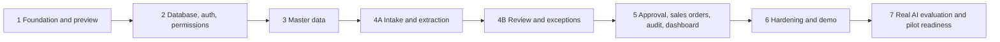

# OrderPilot: Development Roadmap

| | |
|---|---|
| **Status** | v0.2: phase plan approved (P1-1); Phase 1 approved; later phases need approval one at a time |
| **Date** | 2026-10-20 |
| **Depends on** | [PRODUCT_REQUIREMENTS.md](PRODUCT_REQUIREMENTS.md), [USER_FLOWS.md](USER_FLOWS.md), [DATABASE_ARCHITECTURE.md](DATABASE_ARCHITECTURE.md), [TECHNICAL_ARCHITECTURE.md](TECHNICAL_ARCHITECTURE.md), [DESIGN_SYSTEM.md](DESIGN_SYSTEM.md), [TESTING_STRATEGY.md](TESTING_STRATEGY.md) |

> **How to read this document.** The MVP is built in eight phases (1, 2, 3, 4A, 4B, 5, 6, 7). Each phase lists its scope, the decisions it depends on, the approvals it needs, and exit criteria. **Work happens on one approved phase at a time.** Effort figures are **planning estimates for one experienced full-stack engineer**, not commitments; they are re-estimated at the end of every phase. Nothing in this roadmap creates cloud resources, repositories or paid services without your explicit approval at the gate where it is listed.

---

## 1. Delivery principles

1. **Database rules before database-backed screens.** Phase 1 builds the interface against fictional, clearly labelled preview fixtures only. From Phase 2, tenant isolation, permissions, state transitions and inventory rules are proven in Postgres before any real screen depends on them (R-01, R-02).
2. **Vertical slices.** From Phase 3 onwards every phase ends with a working, demonstrable path through the real UI.
3. **Hardest screen gets its own phase.** The review screen is the product's core and its biggest complexity risk (R-13), so it is Phase 4B.
4. **Tests are part of every phase.** A phase is not done until its tests from [TESTING_STRATEGY.md](TESTING_STRATEGY.md) exist and pass. Phase 6 adds hardening, not the first tests.
5. **No fake data presented as real.** The Phase 1 preview uses fictional data labelled on every screen; the real product shows "not enough data" rather than placeholders (FR-DASH-05).
6. **Approval gates for anything external.** Repository hosting, cloud projects, paid plans, third-party processors and deployments each need an explicit yes.

---

## 2. Phase overview

| Phase | Name | Main outcome | Estimate |
|---|---|---|---|
| 1 | Foundation and development preview | Project tooling, design tokens, component library, app shell, interactive preview with fictional data | 1.5 to 2 weeks |
| 2 | Database, authentication, isolation and permissions | Complete schema, RLS, workflow functions, audit capture, sign-in, MFA, workspaces, members, settings | 4 to 5 weeks |
| 3 | Customers, products and inventory | Real master data screens, customer prices, CSV imports | 2.5 to 3 weeks |
| 4A | Intake and extraction | Upload to private storage, duplicate detection, durable extraction queue, simulated provider, fixture documents | 2 to 3 weeks |
| 4B | Review and exceptions | Document viewer, provenance, matching, validation, exceptions, autosave, submit | 4 weeks |
| 5 | Approval, sales orders, inventory effects, audit and dashboard | Atomic approval, backorders, cancel, fulfil, audit screens, live dashboard | 3 to 4 weeks |
| 6 | Hardening, accessibility, refinement and demo | Performance, manual accessibility passes, security review, screenshot tests, demo workspace | 2 to 3 weeks |
| 7 | Real AI evaluation and pilot readiness | Provider evaluation, staging, backups, runbooks, data protection pack | 3 to 4 weeks |
| | **MVP total (Phases 1 to 6)** | | **about 19 to 24 weeks** |

### 2.1 Reconciliation with the v0.1 roadmap

| v0.2 phase | v0.1 equivalent | Change |
|---|---|---|
| 1 | Phase 0 plus the UI part of Phase 2 | UI foundation first, against labelled fictional fixtures only |
| 2 | Phase 1 plus authentication from Phase 2 | Database and authentication together |
| 3 | Rest of Phase 2, plus customer prices and CSV import from Phase 6 | Price validation in 4B needs customer prices; demos need imports |
| 4A, 4B | Phases 3 and 4 | Kept as two separately approved phases |
| 5 | Phase 5 plus audit screens and dashboard from Phase 6 | Dashboard needs sales order data |
| 6 | Phase 6 and part of Phase 7 | Hardening only; tests are written in every phase |
| 7 | Phase 7 plus gate G-7 | Real AI evaluation added; requires paid-service approvals |

---

## 3. Phase details

### Phase 1: Foundation and development preview (approved)

**Goal:** a polished, interactive, development-only preview of OrderPilot, built on the real design system and components, with no backend.

| Scope | Reference |
|---|---|
| Next.js, TypeScript strict, Tailwind CSS, shadcn/ui, ESLint import boundaries, Prettier, pnpm; stable pinned versions (P1-6) | TECHNICAL_ARCHITECTURE §2, §3 |
| Design tokens as CSS variables; Geist Sans and Mono (P1-2); placeholder logo (P1-3) | DESIGN_SYSTEM §3 to §8 |
| Component library: buttons, forms, tables, status badges, provenance markers, exception items, stat tiles, timeline, dialogs, toasts, banners, empty, loading and error states | DESIGN_SYSTEM §9 |
| App shell: sidebar, top bar, breadcrumbs, mobile navigation | DESIGN_SYSTEM §12, §15 |
| Interactive preview for the fictional workspace **Northstar Distribution**: dashboard, customer POs, PO review, approvals, sales orders, customers, products, inventory, audit history, settings, component gallery | PRODUCT_REQUIREMENTS §7.13 |
| Preview isolation: not compiled in production, runtime guard, import boundary, no network | TECHNICAL_ARCHITECTURE §20 |
| Formatting utilities and the permission map as pure TypeScript | DESIGN_SYSTEM §10, PRD §8 |
| Local Git repository with local commits (P1-5) | |

**Not in Phase 1:** Supabase, authentication, real data, uploads, PDF rendering (Phase 4B), persistence of any kind.

**Exit criteria:** lint, typecheck, unit, component and end-to-end tests pass; automated accessibility checks pass on every preview page; production build contains no preview routes.

### Phase 2: Database, authentication, isolation and permissions

**Milestones (approved, each approved separately):**

| Milestone | Scope | Status |
|---|---|---|
| 2A | Local Supabase and database schema: migrations, constraints, indexes, fictional seed, schema tests, generated types | Complete, awaiting approval: 7 migrations, clean reset verified, 130/130 database checks pass |
| 2B | RLS policies, grants, role-checked functions, audit foundation (audit table, tamper-proofing, automatic change recording), seeded users per role, isolation tests | Complete, awaiting approval: 4 migrations, 401/401 database checks pass |
| 2C | Authentication, MFA, invitations, profile, members, settings, workspaces | Complete, awaiting approval: 1 migration (12 total), database and app journey tests listed in TESTING_STRATEGY |
| 2D | Business transactions (approval, stock, fulfilment, cancellation), status guards, extraction job infrastructure, integrity checks, concurrency tests | Complete: 3 migrations (15 total), 604 database checks, concurrency suite |

**Decisions required first:** all ★ decisions in PRODUCT_REQUIREMENTS §15.2 (including D-34 and D-35), open questions Q-1, Q-2, Q-4, Q-5, and a container runtime for local Supabase (R-20).

| Scope | Reference |
|---|---|
| Enumerated types, all tables, composite foreign keys, check constraints, indexes | DATABASE_ARCHITECTURE §5, §6, §15 |
| RLS on every table, minimal grants, `private` helper functions, role-checked functions for sensitive columns (C-03) | §7 |
| Guard triggers for status columns and append-only tables | §7.1, §8.2 |
| Workflow functions from the catalogue, including approval, inventory and extraction queue functions | §9, §10, §14 |
| Audit triggers and domain events; immutability | §13 |
| `pg_cron` jobs for extraction recovery and integrity checks | §6.4, §10.2 |
| Storage bucket and policies (local) | §11 |
| Sign-in, password reset, invitations, TOTP MFA, profile and security page, session expiry | FR-AUTH-01 to 09 |
| Workspace settings, members, roles, workspace switching | FR-ORG-01 to 07 |
| Request proxy, full Content Security Policy with nonces | TECHNICAL_ARCHITECTURE §4, §7.8 |
| Local seed: two workspaces, one user per role in each; operator scripts | §16, TD-06 |

**Dependency:** invitation and password emails use Supabase's local email testing tool only. A real SMTP provider (D-25) is approved separately before any external user.

**Exit criteria:** every table passes the isolation and permission matrices for every role; the concurrency suite leaves the integrity report empty; E2E journeys for sign-in, MFA and invitations pass.

### Phase 3: Customers, products and inventory

| Scope | Requirements |
|---|---|
| Customers, addresses, holds, deactivation, aliases tab | FR-CUST-01 to 08 |
| Products, price changes, track inventory rules | FR-PROD-01 to 04, 07, 08 |
| Customer-specific prices (Should, D-32) | FR-PROD-05 |
| Stock list, receive, adjust, movement history | FR-INV-01 to 09 |
| CSV import for customers, products and opening stock with preview (Should, D-31) | FR-CUST-09, FR-PROD-06, FR-INV-08 |

**Exit criteria:** E2E journeys for master data pass; role-based UI matches the permission map; inventory invariants hold.

**Status:** built. Customers (list, search, create with possible-duplicate warning, edit, hold/release, deactivate/reactivate, addresses with defaults, part-number mappings, order history), products (list with search across SKU, name, GTIN and part numbers; create; edit; discontinue; audited list price changes; tracking rules; customer prices), inventory (stock list with statuses, receive, adjust by quantity or count, movement history). Migration `20261024100000`; pgTAP `012`; E2E `app.master-data.spec.ts`. CSV import (Should, FR-CUST-09, FR-PROD-06, FR-INV-08) is not built.

### Phase 4A: Intake and extraction

| Scope | Requirements |
|---|---|
| Direct-to-storage upload with signed URLs, progress, multi-file | FR-UPL-01 to 04 |
| Server-side verification: signature, page count, SHA-256; duplicate document detection | FR-UPL-02, FR-UPL-05 |
| Signed short-lived view and download links | FR-UPL-06 |
| Provider interface, `extraction.v1` contract, simulated provider (demo workspaces and local or test only) | FR-EXT-01 to 08 |
| Durable queue with leases, claim tokens, retries with backoff, `pg_cron` recovery, idempotent completion | FR-EXT-09 |
| Realtime status updates with polling fallback | TECHNICAL_ARCHITECTURE §12 |
| **Fixture documents:** fictional POs with expected results | TECHNICAL_ARCHITECTURE §9.3 |
| Customer PO list | |

**Exit criteria:** every fixture produces its expected draft; an unknown document produces no values; the retry fixture recovers; killing a worker mid-job leads to recovery without duplicate drafts.

**Status:** built. Direct-to-storage uploads with signed URLs and progress (private local bucket, policies, no update or delete), server-side verification of real type, size, page count and SHA-256, `finalize_document` creating the intake and queued run in one transaction, duplicate-document detection, `extraction.v1` contract, simulated provider recognising four fictional fixtures by hash (local and demo only), our own date and number parsing, worker route and `after()` trigger with `pg_cron` recovery, customer PO list, document viewer and download. Realtime updates use polling (Realtime is not enabled locally). Fixtures: `tests/fixtures/documents`, generated by `scripts/dev/make-fixtures.mjs`.

### Phase 4B: Review and exceptions

| Scope | Requirements |
|---|---|
| Split view with PDF.js viewer; tabs on narrow screens | FR-REV-01 |
| Header and line editing with provenance markers; system defaults labelled | FR-REV-02, FR-REV-03, PR-08 |
| Customer and product matching with method and score; remember aliases | FR-REV-04 to 06 |
| Validation engine for every exception code | FR-REV-07, PRD §9 |
| Field, line and bulk confirmation | FR-REV-08, D-06 |
| Add and remove lines, autosave, optimistic concurrency, claim | FR-REV-09 to 11 |
| Exception resolution and overrides; submit with Override required (D-34) | FR-REV-12, FR-APR-05 |
| Cancel; read-only view for other roles | FR-REV-13, FR-REV-14 |

**Usability check:** moderated sessions with two or three people who process orders today, using the fixtures.

**Exit criteria:** every exception code covered by unit tests and at least one E2E scenario; the review screen is fully keyboard-operable; a 100-line PO is interactive within 2 seconds on the reference dataset.

**Status:** built. Split view with the original document (browser PDF viewer in a same-origin frame rather than PDF.js), header and line editing with provenance markers, confirm per field, per line and in bulk above the confidence threshold (D-06), customer and product matching with method and score, remember-alias, every exception code in a pure validation engine with fingerprints, autosave with optimistic concurrency and "changed by" message, assign to me, overrides and acknowledgements, submit with Override required, cancel, read-only view for other roles. The hard gate also requires a recorded price decision. Not done: moderated usability sessions; the 100-line performance check runs in Phase 6.

### Phase 5: Approval, sales orders, inventory effects, audit and dashboard

| Scope | Requirements |
|---|---|
| Approval queue and approval summary with Override required | FR-APR-01, FR-APR-02 |
| Approve, request changes, reject; independent approval | FR-APR-03, FR-APR-04 |
| Stock decision dialog; allocation and backorder rules | FR-APR-06, D-10, M-01, M-03 |
| Atomic, idempotent approval | FR-APR-07, FR-APR-08 |
| Sales order list and detail; cancel; mark fulfilled with backorder display | FR-SO-01 to 06, D-35 |
| Integration outbox events | PR-11 |
| Entity timelines and workspace audit log | FR-AUD-01 to 05 |
| Role-aware dashboard from real data, including open backorders | FR-DASH-01 to 06 |
| Should: sales order CSV export, audit export, document download events | FR-SO-07, FR-AUD-06, FR-AUD-07 |

**Exit criteria:** the full core workflow passes end to end; parallel approvals produce one sales order; invariants hold after every E2E run; dashboard shows "not enough data" on an empty workspace.

**Status:** built. Approval queue (oldest first, customer and submitter filters, Override required badge) and approval summary (customer, ship-to, totals, lines with availability, exceptions with overrides, changes from AI suggestions, reviewer note, history); approve with the stock decision step, request changes and reject with reasons, independent approval; sales order list (search, status and date filters) and detail (reserved and backordered quantities, price sources, approval and fulfilment details, history), mark fulfilled, cancel, mark backorder handled externally (FR-SO-08, inventory unchanged), CSV export; integration outbox events; entity timelines for every member and the workspace audit log with filters and CSV export (Owner, Admin); role-aware dashboard from real data with "Not enough data yet" below five approvals. Not built: document download audit events (FR-AUD-07, Should).

### Phase 6: Hardening, accessibility, refinement and demo

| Scope | Notes |
|---|---|
| Performance run on the large reference dataset | NFR targets |
| Manual VoiceOver and NVDA passes on core journeys | DESIGN_SYSTEM §14 |
| Internal security review against OWASP ASVS Level 2 | TECHNICAL_ARCHITECTURE §7.11 |
| Screenshot comparison tests for key screens (moved here, S-02) | TESTING_STRATEGY §10 |
| UI refinement from usability findings | |
| Demo workspace seed, banner, reset; scripted demo rehearsal | FR-ORG-06, UF-13 |

**Exit criteria:** the MVP release checklist in [TESTING_STRATEGY.md §15](TESTING_STRATEGY.md) is complete except the items reserved for Phase 7.

### Phase 7: Real AI evaluation and pilot readiness

| Scope | Approval needed |
|---|---|
| Evaluation harness; comparison of providers on anonymised real POs (D-07) | Provider spend, data processing agreements, customer permission for documents |
| Real provider behind the existing interface, if the evaluation supports it | Separate approval after the evaluation |
| Staging environment and deployment pipeline | Cloud projects, region (D-23), paid plans (D-26) |
| Error monitoring (D-30), transactional email (D-25) | Third-party processors |
| Document backup approach and RPO/RTO targets (R-08, D-22) | |
| Operator runbooks; MFA recovery procedure | |
| Data protection pack; terms, privacy policy, DPA template (M-11) | Legal review (external) |

---

## 4. Approval gates

Each gate needs an explicit yes from you. No step below is taken by default.

| Gate | When | What is approved | Status |
|---|---|---|---|
| G-1 | Before Phase 1 | Phase plan and Phase 1 decisions P1-1 to P1-7; local Git only | **Approved** |
| G-2 | Before Phase 2 | ★ decisions, D-34, D-35, open questions, container runtime | Open |
| G-3 | Before each later phase | Start of that phase | Open |
| G-4 | Before any external user | Transactional email provider (D-25) | Open |
| G-5 | Phase 7 | Remote repository hosting; staging environment and region (D-23); error monitoring (D-30) | Open |
| G-6 | Before prospect demos online | Paid hosting plans (D-26), production environment | Open |
| G-7 | Phase 7 | AI provider evaluation spend and data processing agreements (D-07) | Open |
| G-8 | Before the first pilot | Security review sign-off, backup plan, legal documents, retention (D-22) | Open |

---

## 5. Milestones

| Milestone | After phase | What you can see |
|---|---|---|
| M1: Interactive preview | 1 | The full product experience with fictional data, locally |
| M2: Proven foundation | 2 | Sign-in and workspaces; test report showing isolation, permission and inventory guarantees |
| M3: Real master data | 3 | Customers, products and stock, with imports |
| M4: Intake works | 4A | Upload a fixture, watch it extract, see duplicates caught and retries recover |
| M5: Core review | 4B | Full review of messy POs, by keyboard |
| M6: End-to-end workflow | 5 | Upload to confirmed sales order with stock reserved and a full audit trail |
| M7: Demo ready (local) | 6 | Scripted demo on a resettable demo workspace |
| M8: Pilot ready | 7 | Staging deployed, real AI evaluated, security and accessibility reviewed |

---

## 6. After the MVP

Ordered by expected value for the target customers. Each item needs its own approval. Details in [PRODUCT_REQUIREMENTS.md §12](PRODUCT_REQUIREMENTS.md).

| Order | Theme | First step |
|---|---|---|
| 1 | First ERP connector | Choose from pilot customers' systems; build on the outbox |
| 2 | Email intake | Per-workspace inbound address creating intakes from attachments |
| 3 | Units of measure | Conversion tables per product and per customer |
| 4 | Backorder allocation | Depends on D-35 |
| 5 | Approval rules | Value-based and multi-level approvals |
| 6 | PO revisions | Change orders linked to the original sales order |
| 7 | SSO and custom roles | For larger customers (A-01) |
| 8 | Localisation | French (Canada) first, then European languages |

---

## 7. Delivery risks

Technical risks are in [TECHNICAL_ARCHITECTURE.md §18](TECHNICAL_ARCHITECTURE.md). These are risks to the schedule.

| ID | Risk | Mitigation |
|---|---|---|
| DR-01 | Phase 2 decisions arrive late and change the schema | Settle them at G-2; schema changes after Phase 2 are re-estimated explicitly |
| DR-02 | Review screen takes longer than planned | Dedicated phase 4B; Should-have items are the first to move out |
| DR-03 | Preview components diverge from what real data needs | Preview fixtures use the same types the database design defines; components are re-used, not rewritten, in later phases |
| DR-04 | Realistic fixture documents take longer to produce than expected | Start fixtures during Phase 3; keep the set small but varied |
| DR-05 | No access to real order processors for usability checks | Arrange two or three contacts during Phase 3 |
| DR-06 | Pilot blocked by legal or data protection work | Start the data protection pack during Phase 6; legal review runs in parallel |
| DR-07 | Scope creep toward ERP features | Out-of-scope list in PRD §11; every addition goes through a decision |

---

## 8. Roadmap decisions

| ID | Decision | Status |
|---|---|---|
| RD-01 | Phase order as above, including 4A and 4B | **Approved** (P1-1) |
| RD-02 | Should-have items scheduled in Phases 3 and 5 so they can move out without blocking the core workflow | Unresolved |
| RD-03 | Usability sessions at the end of Phase 4B with real order processors | Unresolved |
| RD-04 | One engineer for the estimates above; a second from Phase 3 if calendar time matters more than cost | Unresolved |
| RD-05 | Local demos only until G-6 is approved | Unresolved |
