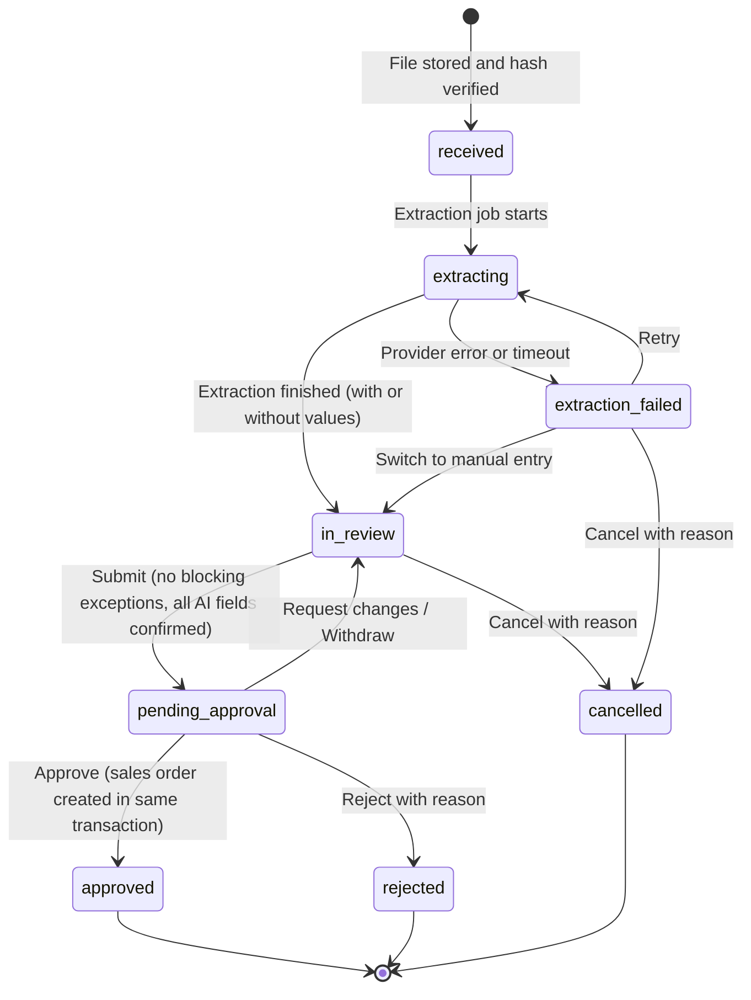
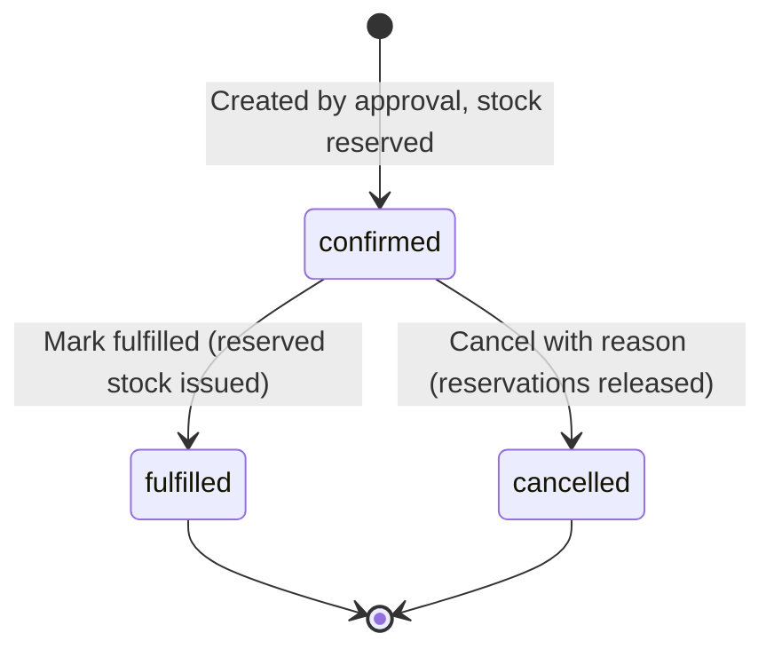

# OrderPilot: User Flows

| | |
|---|---|
| **Status** | Draft v0.2: review corrections applied; Phase 2 decisions still open |
| **Date** | 2026-10-20 |
| **Depends on** | [PRODUCT_REQUIREMENTS.md](PRODUCT_REQUIREMENTS.md) (roles §8, exception codes §9, decisions §15) |

This document describes how each persona moves through OrderPilot: the happy path, the alternatives, and the edge cases. Screen layouts are in [DESIGN_SYSTEM.md](DESIGN_SYSTEM.md). Flow IDs (`UF-05.3`) are referenced by end-to-end tests.

---

## 1. Conventions

- **Roles:** Owner, Admin, Approver, Processor, Inventory Manager, Viewer. "Approver+" means Approver, Admin or Owner.
- **Intake** = the customer PO and its review draft. **Sales order** = the approved result.
- Every step that changes data writes an audit event. Steps list the key audit actions in `monospace`.
- "System" means OrderPilot, never an AI acting on its own authority. Extraction only ever proposes values.

---

## 2. Lifecycles

### 2.1 Intake (customer PO) lifecycle

| Status | Editable draft? | Who acts next |
|---|---|---|
| `received` | No | System |
| `extracting` | No | System |
| `extraction_failed` | No | Processor: retry, manual entry or cancel |
| `in_review` | Yes | Processor |
| `pending_approval` | No (read-only for everyone) | Approver |
| `approved` | No (terminal) | n/a |
| `rejected` | No (terminal) | n/a |
| `cancelled` | No (terminal) | n/a |

### 2.2 Sales order lifecycle

---

## 3. End-to-end persona journeys

### 3.1 Order Processor: a normal morning

1. Jordan signs in and lands on the **Dashboard**. "Needs your attention" shows 6 intakes in review (2 assigned to Jordan) and 1 extraction failure.
2. Jordan drags four PDFs from email into **Upload**. Each becomes an intake. Three are recognised by the extractor within seconds; one is a scan the simulator does not know, so it opens in manual-entry mode.
3. Jordan opens the first intake. The original PDF is on the left, the draft on the right. The customer is suggested ("Account number C-1042 found on document") and Jordan confirms it.
4. The header fields show the AI marker with confidence. Jordan checks each against the PDF and confirms. The requested date `04/11/2026` is flagged as ambiguous because this customer is in the UK. Jordan confirms it as 4 November 2026.
5. Twelve lines: ten matched through existing aliases, all high confidence; Jordan uses **Confirm high-confidence lines**. One line has an unknown customer part number; Jordan searches the catalog, picks the product and ticks **Remember for this customer**. One line is in cases (`CS`) while the product sells by the each (`EA`); Jordan converts 5 CS to 60 EA and notes "Case of 12 per catalog".
6. The exceptions panel is empty except a warning: one line exceeds available stock. Jordan adds a note for the approver and clicks **Submit for approval**.
7. The second intake shows `DUPLICATE_PO_NUMBER`: the customer re-sent yesterday's PO. Jordan opens the linked sales order, sees it is identical, and cancels the intake as "Duplicate". No sales order is created.

### 3.2 Approver: reviewing the queue from a phone

1. Priya opens the **Approvals** queue on a phone between meetings. Three intakes are waiting; the oldest has waited 2 hours.
2. The approval summary for Jordan's intake shows: customer, ship-to, totals; "3 values changed from AI suggestion"; one alias to be remembered; one unit conversion with Jordan's note; one stock warning.
3. Priya taps **Approve**. The system rechecks stock inside the transaction: 40 available, 60 requested. Priya is asked to choose: **Reserve 40 and backorder 20**, or **Request changes**. Priya chooses backorder.
4. Sales order `SO-2026-000412` is created. Stock for that product now shows 40 more reserved. The intake timeline shows every step, from upload to approval.
5. The next intake is from a customer on credit hold. Priya cannot approve without an override. Priya taps **Request changes** with "Hold until finance confirms payment".

### 3.3 Inventory Manager: end-of-day stock

1. Marc opens **Inventory**, filters to "Over-committed" and "Low stock".
2. A delivery arrived: Marc records a **Receipt** of 200 units against the supplier's delivery note number.
3. A cycle count found 3 damaged units: Marc records an **Adjustment** of −3 with reason "Damaged".
4. Marc opens the morning's confirmed sales orders that were picked and shipped outside OrderPilot and clicks **Mark fulfilled** on each. On hand and reserved both decrease.

---

## 4. Detailed flows

### UF-01 Workspace onboarding

**Actors:** Platform operator, Owner, Admin. **Trigger:** a new customer or prospect is signed up.

1. Platform operator creates the workspace: name, slug, country, base currency, timezone. The system creates the default stock location and default settings. `organization.created`
2. Platform operator invites the first Owner by email. `invitation.created`
3. Owner opens the invitation link, sets a password and full name, and is required to enrol TOTP MFA (D-24). `invitation.accepted`, `member.joined`, `mfa.enrolled`
4. Owner reviews **Settings → Workspace**: sales order prefix, independent approval, price tolerance, confidence threshold, duplicate look-back window. `organization.settings_updated`
5. Owner or Admin invites team members with roles. `invitation.created`
6. Admin imports data (Should have, D-31): customers and addresses, products, opening stock. Each import shows a **validation preview** (row-level errors, duplicate SKUs, unknown countries) and writes nothing until confirmed. `import.completed` with counts.
7. Optional: Admin uploads a sample PO to check matching.

**Alternatives and edge cases**
- Invitation expired (after 7 days) → page explains and offers "Ask your admin to resend".
- Invitation email does not match the signed-in user → blocked with explanation.
- Existing user invited to a second workspace → accepts, and the workspace switcher appears.
- Import file with mixed delimiters or encodings → preview shows a clear error; nothing is written.

---

### UF-02 Sign-in, MFA, password reset, session and workspace switching

1. User enters email and password. On success with MFA enrolled, enters a TOTP code.
2. Single workspace → lands on `/o/{slug}/dashboard`. Several → lands on the last used workspace, with a switcher in the sidebar.
3. **Forgot password** → email link → set new password → signed in. The response is identical whether or not the email exists.
4. **Session expiry** while working → the next action redirects to sign-in and returns to the same page. Review edits were autosaved, so nothing is lost.
5. **Membership suspended** while signed in → next request shows "Your access to this workspace has been removed" and offers other workspaces, if any.
6. **Wrong workspace URL** (a slug the user does not belong to) → generic "not found" page that does not reveal whether the workspace exists.

---

### UF-03 Upload customer POs

**Actor:** Processor+. **Entry points:** "Upload PO" button in the top bar (global), Customer POs list, dashboard empty state.

1. User drops up to 10 files or uses the file picker. Optionally selects a customer ("All files are from…").
2. The browser checks type and size immediately and shows per-file errors (for example "Excel files are not supported yet").
3. For each valid file the server creates a pending document record and returns a short-lived signed upload URL. The browser uploads directly to storage with a progress bar.
4. When the upload completes, the server **finalises**: confirms the object exists, verifies the file signature (real PDF, PNG or JPEG), checks page count, computes SHA-256, and creates the intake with status `received`. `document.uploaded`, `inbound_order.created`
5. If the hash matches a document on an active intake or sales order, the intake is flagged `DUPLICATE_DOCUMENT` with a link to the original. Upload is not blocked; submission is.
6. Extraction is queued automatically (UF-04). The list row shows "Extracting…".

**Alternatives and edge cases**
- Network drops mid-upload → retry that file; abandoned pending records are cleaned up and never appear in lists.
- File signature does not match the extension (for example an executable renamed `.pdf`) → rejected at finalise; the stored object is quarantined for deletion; the user sees "This file is not a valid PDF".
- Password-protected PDF → accepted and stored, extraction fails with "Document is password-protected"; user can enter data manually.
- Same file dropped twice in one batch → second is flagged as a duplicate document like any other.

---

### UF-04 Extraction

**Actor:** System (simulated provider in MVP).

1. An extraction run is created (`extraction_run.started`) and the intake moves to `extracting`.
2. The provider receives the stored document and returns structured output conforming to the extraction contract (fields, values, confidence, page references).
3. The output is validated against the contract schema. Valid output is stored **unchanged** on the run, then applied to the draft with provenance `source = ai`, `state = suggested`. `extraction_run.completed`
4. The validation engine runs and creates exceptions. The intake moves to `in_review`.
5. The list and the open page update automatically.

**Simulated provider behaviour**
- Fixtures are recognised **only in demo workspaces and in local and test environments** (M-06). In any other workspace every document is treated as unrecognised.
- Recognised demo document (matched by hash) → returns its prepared result after a short, realistic delay.
- One fixture fails on its first attempt and succeeds on retry, to demonstrate recovery (C-10).
- Unrecognised document → returns an empty result with the reason `document_not_recognised`. The intake opens in **manual-entry mode**: the form is empty, the banner says "No values were extracted. Enter the order from the document." Nothing is guessed.

**Reliability (M-04, M-05)**
- The database job queue is the source of truth. Uploading starts processing immediately as a convenience, but a job that was never started is still picked up by the scheduled recovery job.
- A worker claims a job under a time-limited lease. Only the current lease holder can record the result, and only for the intake's latest run, so a slow or duplicated worker can never overwrite a newer result or create a second draft.
- **Transient failures** (timeout, provider error) are retried automatically with increasing delays, up to 3 attempts. The intake stays in `extracting` and shows "Retrying (attempt 2 of 3)".
- **Permanent failures** (password-protected file, invalid file, output that breaks the extraction contract) and exhausted retries → run marked failed with a reason; intake moves to `extraction_failed`. `extraction_run.failed`
- A scheduled recovery job runs every minute and handles expired leases; opening an intake that is still extracting also triggers the check.

**Failure paths**
- User actions on a failed intake: **Retry** (new run), **Enter manually** (moves to `in_review` with an empty draft), or **Cancel**.

---

### UF-05 Review and validation

**Actor:** Processor+ (other roles see the screen read-only, FR-REV-14). **Entry:** Customer POs list (filter "In review") or dashboard. There are no notifications in the MVP (C-08).

#### UF-05.1 Opening and claiming
1. User opens an intake. If it is unassigned, a banner offers **Assign to me**. If someone else is assigned, the banner says "Assigned to Jordan" with **Take over** (audited). `inbound_order.assigned`
2. The screen shows the document viewer (left), the draft form (right), and the exceptions panel (right rail, or a drawer on smaller screens).

#### UF-05.2 Confirming the customer
1. The customer field shows up to three suggestions, each with a reason: "Account number found on document", "Name similarity 92%", "Ship-to matches saved address".
2. User selects one, or searches, or **Creates customer** inline (name, account number, addresses pre-filled only with values visible on the document, each marked as user-entered once saved).
3. Selecting a customer re-runs validation: on-hold status, duplicate PO number, price expectations and aliases now apply.
4. If the document prints no bill-to address, the customer's default billing address is applied and labelled "Customer default". If no currency is printed, the workspace currency is applied and labelled "Workspace default" (M-10).

#### UF-05.3 Verifying header fields
1. Each AI value has a provenance marker (see DESIGN_SYSTEM.md §9.6) showing confidence. Selecting a field highlights its source page in the viewer.
2. User **confirms** (shortcut: `Enter` on a focused field, or the check button) or **edits** the value. Editing records the original AI value. `inbound_order.field_confirmed`, `inbound_order.field_edited`
3. Missing values stay empty with the "Not found on document" state; the related exception explains what is required.

#### UF-05.4 Verifying and matching lines
1. Lines table shows each line with match status: **Matched by alias**, **Matched by SKU**, **Matched by GTIN**, **Suggested by description**, or **Not matched**.
2. For "Suggested" or "Not matched", user opens the product picker (search by SKU, name, GTIN), selects the product and optionally ticks **Remember for this customer**.
3. **Unit mismatch:** the line shows "PO unit: CS · Sells in: EA". User enters the converted quantity and a short note. The original PO quantity and unit remain visible.
4. **Price check:** if the PO price differs from the expected price, the line shows both. User chooses **Use PO price** or **Use expected price**. The choice is recorded.
5. **Availability** column shows available stock now ("Indicative, checked again at approval").
6. User confirms lines individually, or uses **Confirm high-confidence lines**, which only affects lines whose every field is above the threshold. A confirmation dialog states how many lines and fields will be confirmed. `inbound_order.lines_bulk_confirmed`
7. User may add a line (all values user-entered) or remove a line (reason optional, audited).

#### UF-05.5 Resolving exceptions
The panel lists blocking exceptions first, then warnings. Each item explains the problem in plain language and offers its resolution action. The following are the non-obvious cases:

| Exception | What the user sees | Resolution path |
|---|---|---|
| `DUPLICATE_PO_NUMBER` | "PO 88213 from Harbor & Pine was already received on 18 Oct (SO-2026-000398)." Link to compare. | **Cancel as duplicate** (Processor), or submit with **Override required** for an approver (reason such as "Customer reuses PO numbers for weekly releases"). The override covers only the orders listed; a new conflicting order re-opens it (M-07). |
| `DATE_AMBIGUOUS` | "`04/11/2026` could be 4 Nov or 11 Apr." | User picks the intended date. Hint shows the customer's country and the date format seen on previous orders. |
| `UOM_MISMATCH` | "PO unit CS differs from selling unit EA." | Convert quantity with a note. |
| `PRICE_MISMATCH` | "PO $12.40 vs expected $12.95 (customer price, valid since 1 Sep)." | Choose which price applies. |
| `CUSTOMER_ON_HOLD` | "Customer on hold: 'Overdue invoices', since 2 Oct." | Approver releases the hold on the customer record, or overrides for this order with a reason. A Processor submits with a note; the exception reaches the approver as **Override required** (C-01). |
| `SHIP_TO_MISSING` | "No ship-to address on document." | Select a saved address or type the address exactly as printed elsewhere on the document. If none exists, contact the customer. |
| `PO_NUMBER_MISSING` | "No PO number found." | Enter it if visible. Otherwise submit; an approver overrides with "Customer did not provide a PO number". |

Overrides always require a reason and are shown prominently to the approver. An Approver+ reviewing an intake may override during review; otherwise overridable exceptions travel with the submission as **Override required** (C-01, unresolved decision D-34). `exception.resolved`, `exception.overridden`, `exception.acknowledged`

#### UF-05.6 Saving, concurrency and submission
1. Changes autosave. The header shows "Saved" with time, or "Saving…".
2. If another user saved first, the next save is rejected with "Updated by Alex at 10:42. Reload to see their changes." The user's unsaved edit is shown so it can be re-applied. No silent overwrite.
3. **Submit for approval** is enabled when there are no unconfirmed AI fields and no open blocking exceptions that cannot be overridden. Otherwise the button explains what remains ("2 blocking exceptions, 5 unconfirmed fields"). Overridable blocking exceptions are listed in the submit dialog: "1 item will need an approver override".
4. On submit, the server re-runs validation. If anything changed, submission is refused with the updated list. `inbound_order.submitted`
5. Status becomes `pending_approval`; the draft becomes read-only. The submitter can **Withdraw** while it is pending.

#### UF-05.7 Cancelling an intake
1. User chooses **Cancel intake** and a reason: duplicate, not a purchase order, sent in error, other (free text required for other).
2. Status becomes `cancelled`. The document and history remain available. `inbound_order.cancelled`

---

### UF-06 Approval

**Actor:** Approver+.

1. Approver opens **Approvals** (or the dashboard tile). The queue is sorted by time waiting.
2. Opening an intake shows the **approval summary**:
   - Customer, status, ship-to, requested date, totals.
   - Lines with quantity, price, price source, availability.
   - **Changes from AI suggestion**: every field where the final value differs from the extracted value.
   - **Override required**: each open overridable exception, with an **Override** action that requires a reason (C-01).
   - **Exceptions**: each resolved or overridden exception with who did it and why.
   - **Aliases to be remembered**.
   - Submitter's note; link to the original document (side panel).
3. If independent approval is on and the approver submitted this intake, the actions are disabled with an explanation. **Approve** is also disabled while any Override required item remains, with the explanation "Override or return 1 item before approving".
4. **Approve** → the server runs the approval transaction (DATABASE_ARCHITECTURE.md §9):
   - Re-checks status, permissions, customer status, duplicates, product status, stock.
   - **If stock is short** for any line, nothing is created. The approver sees each short line with available quantity and chooses per line: **Reserve available, backorder rest**, or cancels and uses **Request changes**. Confirming re-runs the transaction with these decisions. When nothing is available (including over-committed stock), the whole line is backordered (M-03). Untracked products are not stock-checked (M-01).
   - On success: sales order and lines created, stock reserved, aliases saved, integration event recorded, intake marked `approved`. `inbound_order.approved`, `sales_order.created`, `inventory.reserved`
5. **Request changes** (reason required) → `in_review`, reason shown as a banner to the reviewer. Confirmations made earlier stay confirmed. `inbound_order.changes_requested`
6. **Reject** (reason required) → `rejected`, terminal; used for orders the business will not fulfil. `inbound_order.rejected`

**Edge cases**
- Two approvers click Approve at the same time → one succeeds; the other sees "Already approved by Priya as SO-2026-000412" with a link. Exactly one sales order exists.
- Double-click on Approve → same result as above; the button is also disabled while the request is in flight.
- Customer placed on hold after submission → approval transaction fails with `CUSTOMER_ON_HOLD`; approver overrides or requests changes.
- Product discontinued after submission → approval fails; approver requests changes.
- Approver's role removed mid-session → server refuses; UI explains.

---

### UF-07 Sales order management

**Actors:** All roles view; Approver+ cancel; Approver+ and Inventory Manager mark fulfilled.

1. **Sales orders** list: search by sales order number, customer PO number, customer; filter by status and date.
2. Detail page: header, address snapshots, lines (ordered, reserved, backordered), price source, approval details, link to intake and original document, timeline.
3. **Mark fulfilled** → confirmation dialog lists quantities to be issued from stock, and any backordered quantities that will **not** be fulfilled through OrderPilot → stock issued → status `fulfilled`, shown as "Fulfilled · 20 EA backordered" when a backorder exists (M-02; follow-up is unresolved decision D-35). `sales_order.fulfilled`, `inventory.issued`
4. **Cancel** (reason required) → reservations released → status `cancelled`. Not available once fulfilled. `sales_order.cancelled`, `inventory.reservation_released`
5. **Export** (Should): CSV and printable view for manual ERP entry.

**Edge case:** an order needs a change after approval → cancel with reason "Customer changed quantities", then process the revised PO as a new intake (D-19). The duplicate check will recognise the PO number on the cancelled order as not active.

---

### UF-08 Customer management

1. **Customers** list → search, filter by status.
2. **New customer**: name, account number, contact, payment terms, notes; then addresses. A similar-name warning appears if a likely duplicate exists.
3. **Customer detail** tabs: Overview, Addresses, Item aliases, Prices (Should), Orders, Timeline.
4. **Place on hold** (Approver+): reason required. Intakes for this customer show `CUSTOMER_ON_HOLD`. **Release hold** clears it on re-validation.
5. **Deactivate / Reactivate** (Admin and Owner): allowed at any time; referenced customers cannot be deleted.
6. **Item aliases**: view, add, edit, remove; each shows its origin ("Learned from SO-2026-000398 by Jordan").

---

### UF-09 Product catalog

1. **Products** list: search by SKU, name, GTIN or alias; filter by status.
2. **New product**: SKU, name, description, selling unit, quantity decimals, list price, GTIN, track inventory, reorder point. For tracked products the system creates the stock balance at the default location.
3. **Edit**: list price changes after creation are Owner and Admin only, show the old value and are audited (M-08). Turning **Track inventory** on creates the stock balance; turning it off is refused while open reservations exist (M-01). SKU changes are allowed but warned ("Customer aliases and open intakes refer to this product by ID, not SKU").
4. **Discontinue**: open intakes containing the product get `PRODUCT_DISCONTINUED` on their next validation.
5. **Customer prices** (Should): add price per customer with validity dates; overlapping validity for the same customer and product is rejected.

---

### UF-10 Inventory

1. **Inventory** list: on hand, reserved, available, reorder point, status chip. Filters: low, out of stock, over-committed.
2. **Receive**: product, quantity, reference, note → `inventory.received`.
3. **Adjust**: product, signed quantity, reason code, note. If the result would make on hand negative, the form refuses with the current on-hand figure. If the result is below reserved, the form warns "This product will be over-committed by N" and requires confirmation. `inventory.adjusted`
4. **Movement history**: every movement with type, delta, resulting on hand and reserved, actor, time, and a link to the related sales order.

---

### UF-11 Audit history

1. **Entity timeline** (on intakes, sales orders, customers, products): chronological events with actor, action and changes. Field edits show "AI suggested `12`, changed to `120` by Jordan".
2. **Audit log** (Owner, Admin, Approver): filter by actor, action, entity type, date range; open the related entity.
3. **Export** (Owner, Admin, Should): CSV of the current filter, recorded as an audit event itself.
4. Times show in the workspace timezone; hovering shows UTC.

---

### UF-12 Team and settings

1. **Settings → Members**: list with role and status; **Invite**; **Change role**; **Suspend**; **Remove**.
2. Guards: the last active Owner cannot be removed, suspended or demoted; Admins cannot change Owners or grant Owner.
3. **Settings → Workspace**: name, timezone, date display, base currency (the Owner may change it until the first customer PO exists, then it is locked, C-04), sales order prefix. Settings changes require MFA (AAL2) and go through an audited database function (C-03).
4. **Settings → Order rules**: independent approval, price tolerance, confidence threshold, duplicate look-back window. Each change is audited with old and new values.

---

### UF-13 Demo workspace (sales demonstration)

A scripted demonstration for prospects, roughly 12 minutes, using the seeded demo workspace and the curated fixture documents. The "Demo data" banner and "Simulated extraction" label stay visible throughout.

| # | Scene | What it proves |
|---|---|---|
| 1 | Dashboard: real counts from seeded history, oldest item waiting, inventory alerts. | Visibility of the order desk. |
| 2 | Upload a clean PO from a known customer → extracted → all lines matched by alias → confirm → submit. | Speed on the happy path. |
| 3 | Upload a messy PO: unknown part number, cases vs eaches, price mismatch, missing ship-to. Resolve each. | Catches costly mistakes; human stays in control. |
| 4 | Upload the same PO again → `DUPLICATE_PO_NUMBER` and `DUPLICATE_DOCUMENT` → cancel as duplicate. | Duplicate prevention. |
| 5 | Switch to the Approver: approval summary shows changes from AI and decisions → approve with a stock shortfall → backorder. | Controlled approval; accurate inventory. |
| 6 | Sales order detail → inventory reserved → timeline from upload to approval. | Audit trail. |
| 7 | Upload an unknown document → manual-entry mode, nothing invented. | Honesty about automation. |
| 8 | Reset the demo workspace for the next prospect (operator action). | Repeatability. |

---

### UF-14 Profile, security and MFA recovery

1. **User menu → Profile and security**: change full name and password; enrol or re-enrol TOTP MFA; see last sign-in time (FR-AUTH-08).
2. **Lost authenticator** (FR-AUTH-09): the user asks a workspace Owner → the Owner contacts the platform operator → the operator verifies the request out of band and removes the factor with an audited operator procedure → the user signs in with password and must re-enrol before any privileged action. `mfa.factor_removed`, `mfa.enrolled`

---

## 5. Cross-cutting edge cases

| Situation | Expected behaviour |
|---|---|
| Very large PO (500 lines) | Lines table virtualises rows; bulk confirmation; validation runs server-side within the performance target. |
| Multi-page PO with repeated headers | Extraction contract supports page references per line; reviewer sees the page for each line. |
| Two processors editing the same intake | Optimistic concurrency: second save is refused with who and when; no silent overwrite. |
| Approver opens an intake that was withdrawn | Page shows the current status and that it was withdrawn by whom. |
| User changes workspace settings during review | Validation uses current settings at each run; submission and approval re-validate. |
| Product price changes after submission | Approval uses the price decided during review; the summary notes "Expected price changed since submission". |
| Browser offline | Banner "You are offline. Changes will not be saved." Actions disabled until reconnected. |
| Server error | Friendly message with a request ID; the user's input is preserved. |
| Permission denied | Message explains which role is needed; nothing partially happens. |
| Document cannot be rendered in the viewer | Download link still available; review can continue. |
| Extremely long text in fields (for example notes) | Limits enforced with counters; values truncated only in display, never in storage. |
| Malicious content in a document (script text, prompt-like instructions) | Treated as plain text everywhere; never executed or interpreted as instructions. |
